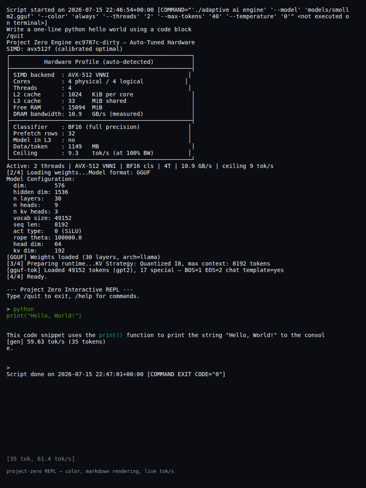
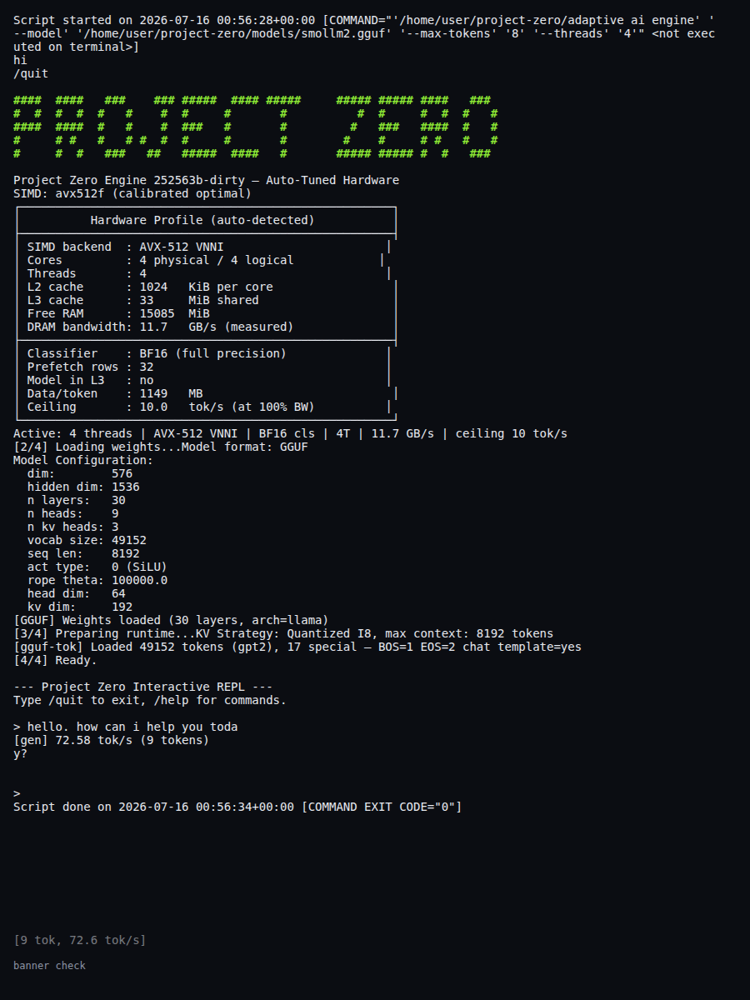
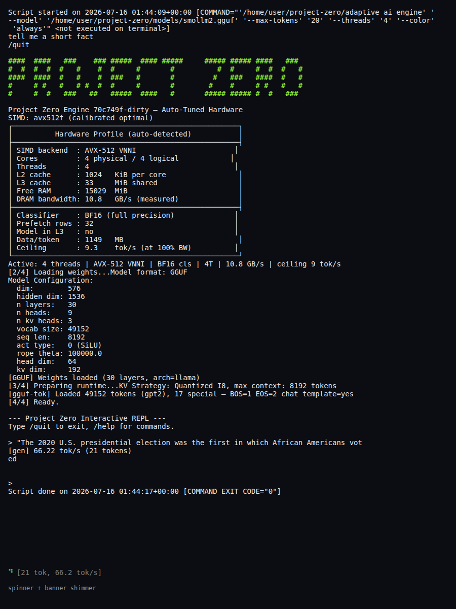

# Project Zero — CPU LLM Inference Engine

[](LICENSE)
[](src/)
[](src/math/)
[](#benchmarks)
[](CONTRIBUTING.md)

<p align="center">
  
</p>

[Benchmarks](#benchmarks) · [Quick Start](#quick-start) · [UI/UX](#ui-ux) · [Help Wanted](#help-wanted) · [Docs](docs/)

---

C99 (plus one C++17 file for chat templates), single binary (`pz`). Runs Microsoft's BitNet b1.58 **5.4× faster than Microsoft's own `bitnet.cpp` at 4 threads (up to 8.3× single-threaded)** with its converted ternary weights and INT4 output layer on an i5-11300H laptop, PrismML's Bonsai-27B **4.2–4.8× faster than PrismML's own engine fork**, DeepSeek-V2-Lite **faster than llama.cpp**, and dense GGUF models — no GPU, no Python, no ML framework.

- **No third-party dependencies** — `make release`, one executable; the prebuilt release binary needs only libc/libm
- **4.9–8.3× faster than bitnet.cpp on an i5-11300H** (converted ternary weights, INT4 output layer, June 2026). On a 4-vCPU Xeon with the official I2_S GGUF and a 16-bit output layer, bitnet.cpp leads by 7–17% (October 2026) — [details ↓](#benchmarks)
- **35.79 tok/s** BitNet b1.58 2B on an i5-11300H laptop (INT4, 500 tokens, best of 3)
- **Several users at once** — `--parallel N` batches concurrent chat requests: 2.2–2.7× aggregate throughput (October 2026)
- **MoE faster than llama.cpp** — DeepSeek-V2-Lite-Chat Q4_K_S at 4 threads: **11.7–12.6 tok/s vs llama.cpp's 9.4–10.5** on a 4-vCPU AVX-512 VNNI Xeon
- **One binary, many model families** — BitNet b1.58 / Falcon3-1.58bit ternary, Bonsai Q2_0, dense GGUF, DeepSeek-V2 and Qwen3 MoE, Mamba-1 — no per-model rebuild

---

### Bonsai-27B on ordinary x86 — faster than the vendor's own engine

Project Zero runs [PrismML's Ternary-Bonsai-27B](https://huggingface.co/prism-ml/Ternary-Bonsai-27B-gguf) (ternary Q2_0, 7.16 GB, Apache 2.0) **4.2–4.8× faster than PrismML's own llama.cpp fork at every thread count** on a plain 4-core AVX-512 Xeon VM — **2.97 vs 0.70 tok/s at t=4** (60-token greedy decode, identical file/prompt/session, drift-bracketed by sentinel runs; [18 raw terminal captures + methodology](benchmark_results/sweep3_2026-07-18/) · [full comparison](docs/BENCHMARK.md#bonsai)).

Run it yourself — one binary, no Python (model download ~7.2 GB):

```bash
git clone https://github.com/shifulegend/project-zero && cd project-zero && make release
curl -fL --create-dirs -o models/Ternary-Bonsai-27B-Q2_0.gguf \
  https://huggingface.co/prism-ml/Ternary-Bonsai-27B-gguf/resolve/main/Ternary-Bonsai-27B-Q2_0.gguf
./pz --model models/Ternary-Bonsai-27B-Q2_0.gguf \
  --prompt "What is the capital of France?" --max-tokens 60 --temperature 0 --threads 4
```

---

<a id="benchmarks"></a>

## Benchmarks

The latest result for each system tested: a system's most recent run is its latest. Every earlier
run and the full investigations (Ternary-Bonsai-27B, Qwen3-8B, classifier formats):
[`docs/BENCHMARK.md`](docs/BENCHMARK.md). Decode tok/s, strictly sequential runs, temperature 0.

### Intel Xeon cloud VMs (4 vCPU, AVX-512 VNNI), latest per model

| Model (format) | Compared with | Result (1 / 2 / 3 / 4 threads) | Date | Data |
|---|---|---|---|---|
| SmolLM2-135M (F16) | llama.cpp | **+13% / +18% / +5% / −3%** (best of 3) | 2026-10-22 | [logs + screenshots](benchmark_results/h2h_smollm2_135m_2026-10-22/) |
| SmolLM2-1.7B (Q4_K_M) | llama.cpp | −8% / −8% / −7% / −12% | 2026-10-19 | [report §AL](docs/PERFORMANCE_CEILING_REPORT.md) · [logs](benchmark_results/sweep_h2h_2026-10-19/) |
| BitNet b1.58 2B-4T (official I2_S GGUF, 16-bit output layer on both) | bitnet.cpp | −17% / −11% / −7% / −15% | 2026-10-19 | [report §AL](docs/PERFORMANCE_CEILING_REPORT.md) · [logs](benchmark_results/sweep_h2h_2026-10-19/) |
| DeepSeek-V2-Lite-Chat (Q4_K_S, MoE + MLA) | llama.cpp | **11.7–12.6 vs 9.4–10.5** at 4 threads (64 tokens) | 2026-10-21 | [`CHANGELOG.md`](CHANGELOG.md) |
| Ternary-Bonsai-27B (Q2_0) | PrismML's llama.cpp fork | **4.2–4.8× faster** at every thread count (4 threads: 2.97 vs 0.70) | 2026-07-18 | [captures + methodology](benchmark_results/sweep3_2026-07-18/) |
| Qwen3-8B (Q4_K_M, AVX2-only VM) | llama.cpp | 2.5–2.7 vs **4.0–4.8** at 4 threads (llama.cpp 1.6–1.9× faster) | 2026-07-31 | [screenshots](benchmark_results/qwen3_8b_dense_2026-07-31/screenshots/) · [investigation](docs/BENCHMARK.md#qwen3-8b-dense-q4_k_m--bringing-up-a-previously-untested-architecture-and-an-honest-gap-vs-llamacpp) |
| Parallel serving, SmolLM2 135M / 1.7B | `--parallel 1` (one at a time) | **2.2–2.3×** aggregate tok/s with 4 clients, 2.4–2.7× with 8 | 2026-10-22 | [results + screenshots](benchmark_results/parallel_2026-10-22/) |

The VM's CPU model differs between dates (each run's log records it), so compare engines within a
row, not rows with each other.

<p align="center">
  
</p>

Real terminal sessions (2026-10-22, SmolLM2-135M F16, 4 threads, 300 tokens, `tools/screenshots/cli/capture.mjs`):

| Project Zero · **104.1 tok/s** | llama.cpp · **87.9 tok/s** |
|---|---|
|  |  |

Accuracy: perplexity matches llama.cpp within 0.7% on SmolLM2-135M/1.7B, Qwen2.5-0.5B, Qwen3-0.6B
and Mamba-130m ([report](docs/reports/ACCURACY_PARITY_2026-10-19.md), 2026-10-19).

### Intel Core i5-11300H laptop (4C/8T, 16 GB DDR4, AVX-512 VNNI), latest: 2026-06-21

Same model, prompt and machine for both engines, 500 tokens, best of 3 per thread count.

| Threads | BitNet b1.58 2B-4T: PZ INT4 | PZ BF16 | bitnet.cpp | SmolLM2-135M F16: PZ | llama.cpp |
|---|---|---|---|---|---|
| 1 | **16.98** | 11.64 | 2.04 | **58.00** | 53.50 |
| 2 | **27.99** | 20.23 | 3.76 | **86.03** | 84.20 |
| 3 | **33.82** | 22.31 | 5.17 | 100.44 | **106.20** |
| 4 | **35.79** | 23.42 | 6.64 | 98.28 | **102.10** |
| 5 | **31.80** | 21.62 | 5.15 | **95.93** | 93.90 |
| 6 | **33.68** | 22.28 | 6.01 | 89.63 | **94.90** |
| 7 | **32.50** | 21.50 | 6.61 | 90.57 | **95.30** |
| 8 | **32.03** | 21.28 | 6.04 | 83.32 | **86.30** |

BitNet (converted ternary `.bin`, INT4 output layer): **4.9–8.3× faster than bitnet.cpp**. SmolLM2:
ahead at 1, 2 and 5 threads (+8%, +2%, +2%), 3.5–5.6% behind at the others.

| BitNet · PZ INT4 · t=4 · **35.79 tok/s** | BitNet · bitnet.cpp · t=4 · **6.64 tok/s** | SmolLM2 · PZ · t=3 · **100.44 tok/s** | SmolLM2 · llama.cpp · t=3 · **106.20 tok/s** |
|---|---|---|---|
|  |  |  |  |

<p align="center">
  
</p>

All 40 screenshots: [`benchmark_results/sweep_2026-06-21/screenshots/`](benchmark_results/sweep_2026-06-21/screenshots/) ·
third-party result on OpenBenchmarking.org: [i5-11300H vs llama.cpp](https://openbenchmarking.org/result/2606208-SHIF-PROJECT03).

### Community results

Intel i5-8350U (ThinkPad T480, AVX2): Ternary-Bonsai-27B at ~0.1 tok/s, pointing at a slow AVX2
path for that ternary format ([report](https://old.reddit.com/r/LocalLLaMA/comments/1v3pn1w/built_a_fromscratch_bitnet_inference_engine_in/p0wktod/)).
Run it yourself and post your result: [Discussion #3](https://github.com/shifulegend/project-zero/discussions/3).

---

<a id="quick-start"></a>

## Quick Start

**Option A — installer (Linux x86-64, no compiler, no root):**

```bash
curl -fsSL https://raw.githubusercontent.com/shifulegend/project-zero/master/install.sh | sh
# models are not bundled; e.g. SmolLM2-135M-Instruct (F16 GGUF, ~271 MB):
curl -fL -o SmolLM2-135M-Instruct-f16.gguf \
  https://huggingface.co/bartowski/SmolLM2-135M-Instruct-GGUF/resolve/main/SmolLM2-135M-Instruct-f16.gguf
pz --model SmolLM2-135M-Instruct-f16.gguf --prompt "What is the capital of France?" --temperature 0
```

It finds the newest release (pre-releases included), checks the archive against the release's
`SHA256SUMS` (and refuses to install on a mismatch or a missing entry), puts `pz` in
`~/.local/bin` (and tells you if that is not on your `PATH`), and offers the optional `pz config`
setup. Options: `--version X.Y.Z`, `--prefix DIR`, `--repo OWNER/NAME`, `--yes`, `--no-wizard`,
`--uninstall` (`sh install.sh --help`). Works from release 0.2.0 on; your settings and models are
never touched.

**Or by hand:**

```bash
VER=0.2.0   # example: use the version shown on the Releases page
NAME=project-zero-$VER-x86_64-unknown-linux-gnu
wget https://github.com/shifulegend/project-zero/releases/download/v$VER/$NAME.tar.gz
wget https://github.com/shifulegend/project-zero/releases/download/v$VER/SHA256SUMS
sha256sum -c --ignore-missing SHA256SUMS && tar xf $NAME.tar.gz && cd $NAME
./pz --model /path/to/model.gguf --prompt "What is the capital of France?"
```

The archive holds `pz`, `LICENSE`, `README.md` and `CHANGELOG.md`. Quantized/dense GGUF models need
an AVX2 CPU (Haswell, 2013+); BitNet ternary runs on any x86-64-v2 CPU, and AVX-512/VNNI is used
automatically when present.

v0.1.0 (before the Phase 39 rename) shipped `adaptive_ai_engine-0.1.0-x86_64-linux.tar.gz` with an
`adaptive_ai_engine` binary — same program, old name. v0.2.0 still includes an
`adaptive_ai_engine` → `pz` alias symlink that prints a deprecation notice; it is removed in v0.3.0.

**Option B — build from source (60 seconds):**

```bash
git clone https://github.com/shifulegend/project-zero.git
cd project-zero
make demo   # builds engine + downloads SmolLM2-135M + runs a test prompt
```

Expected output: `The capital of France is Paris.`

No GPU. No Python at runtime. No API key. GCC or Clang (C and C++ compilers) + `make` + `curl` (or
`wget`) — nothing else.

**Guided setup (optional):** `pz config` walks you through five plain-language steps (model,
processor use, memory for long chats, chat-page port, update notices). Each step says what it
means, shows example choices and their effect, and how to change it later. It can download a
checksum-verified starter model suited to your computer's free memory and open the chat page
when you are done. It writes
`~/.config/project-zero/config.toml` (`PZ_CONFIG` overrides the location); `pz config
list|get|set|add|unset|path` edits it non-interactively, and every key can also be set as a
`PZ_<KEY>` environment variable. Precedence: command-line flag > environment > file > default;
`--no-config` ignores the file and environment.

---

<a id="help-wanted"></a>


> If you like my work or if it helped you, buy me a coffee or A100😉
> 
> [](https://github.com/sponsors/shifulegend)

## Help Wanted

Two open problems where outside expertise would make a real difference:

| Problem | Current state | Target |
|---|---|---|
| **Dense Q4_K throughput** | Q4_K weights already run through native Q4_K kernels without widening to F32 (including a byte-exact port of llama.cpp's Q4_K x8 repack), yet Qwen3-8B Q4_K_M decodes at ~2.5–2.7 tok/s vs llama.cpp's 4.0–4.8 on the same host. Six measured attempts have not closed it, and the "kernel efficiency" hypothesis has been falsified — see the [Qwen3-8B investigation](docs/BENCHMARK.md#qwen3-8b-dense-q4_k_m--bringing-up-a-previously-untested-architecture-and-an-honest-gap-vs-llamacpp). | Root-cause and close the gap to `llama.cpp` |
| **Re-benchmark classifier INT8/INT4 throughput post-quality-fix** | `matmul_i4_task`/`matmul_i8_task` (`src/math/parallel_matmul.c`) were rewritten 2026-07-31 to fix a real quantization-quality gap (one scale per row → one scale per 32-element block with error-minimizing search — see `docs/ai/decision-log.md`, [GitHub issue #27](https://github.com/shifulegend/project-zero/issues/27)). That rewrite dropped the VNNI `dpbusds`/VBMI fast paths (their row-wide bias-correction trick doesn't hold once every block has its own scale) in favor of a portable per-block FMA path — the specific SSE-interleave-unpack throughput issue this row used to describe no longer applies to the current code, but the *net* throughput effect of the whole rewrite hasn't been re-measured against the historical sweep in [`docs/BENCHMARK.md`](docs/BENCHMARK.md). | Confirm INT8/INT4 throughput post-fix; a genuine multi-row/multi-block SIMD kernel (not full VNNI dpbusds, which the new per-block scaling structurally can't reuse) could recover some of the dropped throughput without regressing quality |

Existing SIMD work documented in [`docs/KERNEL_INTERNALS.md`](docs/KERNEL_INTERNALS.md).
(The former MoE help-wanted item is solved: DeepSeek-V2-Lite now runs faster than llama.cpp — see [Benchmarks](#benchmarks).)

---

## What It Does

Runs on commodity CPUs — from scratch, in C:

- **Ternary:** [Microsoft's BitNet b1.58-2B-4T](https://huggingface.co/microsoft/bitnet-b1.58-2B-4T) (converted `.bin`, or the official I2_S GGUF — its embedded chat template is broken, use `--chat-template-file docs/templates/bitnet-b1.58.jinja`), Falcon3-1.58bit (I2_S GGUF), and Qwen 3.5/3.6 hybrid-attention models such as Ternary-Bonsai-27B (Q2_0).
- **Mixture of experts:** DeepSeek-V2 / V2-Lite (MoE + MLA) and Qwen3-MoE GGUF models.
- **Dense GGUF transformers** (e.g. SmolLM2, Qwen3-8B) and **Mamba-1** state-space models, with every mainline GGUF quant type (F16/BF16, the legacy and K-quants, and the IQ1–IQ4 families).

Also included in the same binary: an OpenAI-compatible HTTP API with a built-in web chat UI (`--server --port 8080`), grammar-constrained JSON mode (`--json`; output always starts with `{` or `[`), a configurable sampler chain and stop sequences, speculative decoding (`--draft-model`), LoRA adapters (`--lora`), int8/int4 or disk-backed KV cache (`--kv-type`, `--kv-offload`), KV prefix reuse across requests (`--prompt-cache`), best-of-N and step-level tree search (`--best-of`, `--mcts*`, `--prm`), toggleable watermarking (`--watermark*`), distributed pipeline inference (`--remote-layers`, `--rpc-worker`), persistent RAG memory (`--memory-db`), SigLIP vision pipeline (`--vision`), an agentic tool-use loop (`/agent`), persistent settings (`pz config`) and notify-only update checks (`--check-update`).

Control tokens such as `<|im_start|>` typed or pasted into a chat message (or returned by a tool) are read as plain text, so a message cannot end its turn or forge a system turn.

**Models tested** (each verified end to end on a real file; formats beyond these load through the
same generic paths):

| Model | Format | Verified by |
|---|---|---|
| BitNet b1.58 2B-4T | converted `.bin`, official I2_S GGUF | benchmarks vs bitnet.cpp, perplexity |
| Falcon3-3B-Instruct-1.58bit | I2_S GGUF | chat output, end of turn (2026-10-22) |
| Ternary-Bonsai-27B (Qwen 3.5 hybrid) | Q2_0 GGUF | benchmarks vs PrismML's fork |
| DeepSeek-V2-Lite-Chat | Q4_K_S, Q2_K GGUF | golden output, benchmark vs llama.cpp |
| Qwen3-8B | Q4_K_M GGUF | token-for-token vs llama.cpp, benchmark |
| Qwen3-0.6B, Qwen2.5-0.5B-Instruct | Q8_0 GGUF | perplexity vs llama.cpp |
| SmolLM2-135M / 1.7B-Instruct | F16, Q8_0 / Q4_K_M GGUF | benchmarks, perplexity, parallel serving |
| Mamba-130m | F16 GGUF | perplexity vs llama.cpp, thread sweep |

Qwen3-MoE GGUF loading is implemented but not yet verified on a real file.

No GPU required. Python is offline tooling only (model conversion, testing).

> ⚠️ **Before contributing:** read [`GOLDEN_RULES.md`](GOLDEN_RULES.md). No hardcoding. Test after every change.

---

## Hardware

Memory bandwidth is the bottleneck — for BitNet b1.58-2B the engine reads 420–680 MB of weights per token. SIMD backend and thread count are auto-detected at startup; the DRAM bandwidth probe is cached per host (`--calibrate` or `PZ_BW_REPROBE=1` re-measures).

How the memory setup changes speed (BitNet b1.58-2B, i5-11300H, measured with an **early build**
(first half of 2026, before the INT4/VNNI kernels); today's build does 35.79 tok/s on the same
laptop, see [Benchmarks](#benchmarks)). The ratios still apply: speed follows memory bandwidth.

| RAM config | BitNet tok/s (early build) | Notes |
|---|---|---|
| 4 GB | ~8–10 | disable earlyoom |
| 8 GB single-channel DDR4 | ~13 | bandwidth ceiling |
| 16 GB dual-channel DDR4-2667 | ~15.5–16.1 | measured: +24% over single-channel ([report §A1](docs/PERFORMANCE_CEILING_REPORT.md)) |

SIMD: AVX-512 VNNI → AVX-512F → AVX-VNNI → AVX2 → ARM NEON/dotprod → scalar, selected at startup (`--simd` forces a tier). Quantized/dense GGUF models need at least AVX2 on x86.

---

## Architecture

```
project-zero (binary: pz)
├── src/math/       ternary (VNNI / AVX-512BW LUT / AVX2 / NEON), Q2_0, K-quant, Q8_0, int4-KV kernels
├── src/core/       weight + GGUF loading (architecture-agnostic), quant formats, run state
├── src/memory/     mmap (zero-copy), aligned allocation, disk-backed buffers
├── src/sampling/   sampler chain (penalties, top-k, min-p, temperature, top-p), JSON grammar, watermark
├── src/threading/  spin-then-sleep thread pool
├── src/transformer/ forward pass, attention (MHA/GQA, MLA, hybrid), MoE, Mamba, generation loop
├── src/kv_cache/   KV strategy (f32/int8/int4), sliding window, prefix + prompt cache
├── src/api/        OpenAI-compatible HTTP server and the embedded web UI
└── src/config/     persistent settings (`pz config`, PZ_* env, config file)
```

Key design choices: `mmap` + `POSIX_MADV_WILLNEED` for weight loading, runtime SIMD dispatch via function pointers, KV cache sized from free RAM (`--ctx-size`, `--kv-ram-fraction`) with optional int8/int4 storage and a sliding window, BF16 embeddings (660 MB smaller vs F32), model shape/tokenizer/quant read from GGUF metadata — never hardcoded.

---

## Build

```bash
make release      # -O3 -march=native (default)
make debug        # ASan + UBSan
make test         # builds and runs every tests/*.c under ASan/UBSan
make dist         # portable x86-64 binary with runtime SIMD dispatch (what releases ship)
make demo         # release build + SmolLM2-135M download + a test prompt
make clean
```

Requirements: GCC or Clang with its C++ compiler (one C++17 file, the chat-template renderer), pthreads, libm. No other dependencies. `make` also creates an `adaptive_ai_engine` → `pz` symlink, the deprecated old name, removed in v0.3.0.

---

## CLI Reference

```bash
./pz \
  --model   models/bitnet-b1.58-2B-4T.bin \
  --tokenizer models/bitnet-b1.58-2B-4T_tokenizer_proper.bin \
  --prompt  "Your prompt here" \
  --threads 4 \
  --max-tokens 256
```

GGUF models carry their own tokenizer, so `--tokenizer` is only needed for native `.bin` models. Omit `--prompt` to start the interactive REPL.

Key flags:

- Sampling: `--temperature`, `--top-p`, `--top-k`, `--min-p`, `--repeat-penalty`, `--presence-penalty`, `--frequency-penalty`, `--repeat-last-n`, `--seed`, `--stop`, `--system-prompt`, `--json`
- Context and KV cache: `--ctx-size`, `--kv-ram-fraction`, `--kv-type f32|i8|i4`, `--kv-offload <dir>`
- Hardware: `--threads`, `--simd {auto|avx2|avx512f|vnni|scalar}`, `--classifier {auto|bf16|int8|int4|auto-fast}`, `--calibrate`
- Models and templates: `--chat-template-file <f>`, `--raw-prompt`, `--draft-model <gguf>`, `--lora <file>`, `--perplexity <file>`
- Server: `--server --port 8080`, `--cors`, `--api-key`, `--metrics`, `--queue-size`, `--parallel`
- Other: `--memory-db path.vrdb`, `--image photo.jpg --vision vision.bin --proj projector.bin`, `--no-config`, `--no-update-check`, `--version`

Full flag reference: `./pz --help`. REPL commands (`/help`, `/think`, `/agent`, `/memory …`) and every API route: [`docs/WEBUI_GUIDE.md`](docs/WEBUI_GUIDE.md).

---

<a id="ui-ux"></a>

## UI/UX

> Full how-to (starting the server, every web UI control, REPL commands, CLI flags, API routes):
> [`docs/WEBUI_GUIDE.md`](docs/WEBUI_GUIDE.md).

**Web chat UI** — a browser-based chat interface embedded directly in the binary (no separate
install): streaming responses, stop/cancel mid-generation, a dark/light theme and image upload
(when the server is started with `--vision`/`--proj`). The Settings panel is built from
`GET /v1/config`, so it starts from the server's own defaults: sampling and repetition controls,
seed, JSON mode, prompt cache, stop sequences, watermark, system prompt, tree search and a
chat-template editor. **Settings → Server defaults** shows whether each server value comes from
the config file, an environment variable or a command-line flag, and saves changed settings (and
the web UI title) as defaults for the next start (turn off with `--no-config-write`).
**Settings → Updates** and a banner report newer releases (notify only).

```bash
./pz --model models/smollm2.gguf --server --port 8080
# open http://127.0.0.1:8080/ in a browser
```

| Light (reply) | Dark (Settings) |
|---|---|
|  |  |

*Captured 2026-10-23 from v0.2.0 (SmolLM2-1.7B Q4_K_M) with `tools/screenshots/webui/chat.spec.mjs`.*

**CLI/REPL polish** — colored output (`--color auto\|always\|never`, respects `NO_COLOR`), a
model-load progress indicator, a live tok/s status line during generation, and markdown/code
rendering in the interactive REPL:



**Startup banner** — an animated ASCII-art "PROJECT ZERO" splash (bottom-up slide-in reveal, a
hand-crafted 5-row block font, no external figlet dependency) that finishes with a brief
dim/bold shimmer, shown on **every** run including scripted one-shot `--prompt` invocations and
piped/redirected output — TTY runs get the full animation, non-TTY runs get the same banner as
plain `#`/space text with zero escape codes, so redirected output and benchmark captures always
show it too (previously it silently no-op'd on non-TTY output; fixed 2026-07-24):


Static frame, for reference:



**Live "thinking" spinner** — a continuously animated braille spinner (bold cyan), advancing
once per streamed token next to the live tok/s status line, the same idea as Claude Code's
animated indicator while it's actively working:



**HTTP API hardening** — CORS (`--cors`/`--cors-origin`), optional API-key auth (`--api-key`,
off by default), Prometheus metrics (`--metrics` → `GET /metrics`), interactive docs
(`GET /docs`, `GET /openapi.json`), and a cancel endpoint (`POST /v1/chat/completions/cancel`)
that actually stops an in-flight generation, backed by a concurrency rearchitecture (per-
connection threads + a generation queue) so static/metrics/docs requests are never blocked
behind a running chat completion. By default one generation runs at a time; `--parallel N`
serves up to N chat requests at once, batched into one forward pass per token (dense attention
models; others stay sequential and `/v1/config` says why). With 4 clients at once, aggregate
throughput rises 2.2–2.3× over one-at-a-time serving (SmolLM2-135M Q8_0: 45 → 101 tok/s;
SmolLM2-1.7B Q4_K_M: 12.7 → 29.8 tok/s), and 2.4–2.7× with 8 (4-vCPU Xeon, 4 threads, 2026-10-22 17:30–17:36 UTC,
[results and terminal screenshots](benchmark_results/parallel_2026-10-22/)). When every slot is busy a chat request
gets `429`, or waits in order with `--queue-size N` (`--queue-timeout S`). Ctrl+C/SIGTERM stops
running generations and shuts the server down cleanly.

Design decisions are checked against a written [design-principles reference](docs/design/ui-ux-principles.md)
before being accepted — see the [Phase 22.4 review](docs/design/review-2026-07-15.md) for the
full pass/fail breakdown (one real bug and one design-checklist violation were caught and fixed
during that review, not just cosmetic nits).

---

## Docs

| Document | What it covers |
|---|---|
| [BENCHMARK.md](docs/BENCHMARK.md) | Every benchmark run with dates, screenshots and investigations |
| [KERNEL_INTERNALS.md](docs/KERNEL_INTERNALS.md) | AVX-512 VBMI kernel, MoE scatter problem, thread pool design |
| [PERFORMANCE_CEILING_REPORT.md](docs/PERFORMANCE_CEILING_REPORT.md) | Full optimization journal: 1.4 → 36.25 tok/s, bandwidth math |
| [DEBUGGING_JOURNAL.md](docs/DEBUGGING_JOURNAL.md) | Root-cause log of every major perf regression and fix |
| [WEBUI_GUIDE.md](docs/WEBUI_GUIDE.md) | Web UI controls, REPL commands, CLI flags, HTTP API routes |
| [IMPLEMENTATION_PLAN.md](docs/architecture/IMPLEMENTATION_PLAN.md) | Phase-by-phase plan and current status of every phase |
| [ROADMAP.md](.github/ROADMAP.md) | Roadmap overview, language and dependency goals |
| [CHANGELOG.md](CHANGELOG.md) | User-facing changes per release (and `[Unreleased]`) |
| [RELEASING.md](docs/RELEASING.md) | Release assets, installer, supported models, minimum CPU |
| [SECURITY.md](SECURITY.md) | Supported versions and how to report a vulnerability |
| [CONTRIBUTING.md](CONTRIBUTING.md) | Build, test, and contribution protocol |
| [DEVELOPER_ONBOARDING.md](DEVELOPER_ONBOARDING.md) | Testing mandate, QA protocol, branching strategy |

---

*v0.2.0 · BitNet b1.58-2B-4T · Falcon3-1.58bit · Ternary-Bonsai-27B · DeepSeek-V2-Lite-Chat · Qwen3-8B · Qwen3-0.6B · Qwen2.5-0.5B · SmolLM2-135M/1.7B · Mamba-130m · SigLIP vision*
*Latest: **35.79 tok/s** BitNet INT4 and **5.4× vs bitnet.cpp** at 4 threads (i5-11300H, 2026-06) · **104.1 tok/s** SmolLM2-135M F16 (4-vCPU Xeon, 2026-10) · **11.7–12.6 tok/s** DeepSeek-V2-Lite, ahead of llama.cpp (2026-10) · **2.2–2.7×** with `--parallel` (2026-10)*
