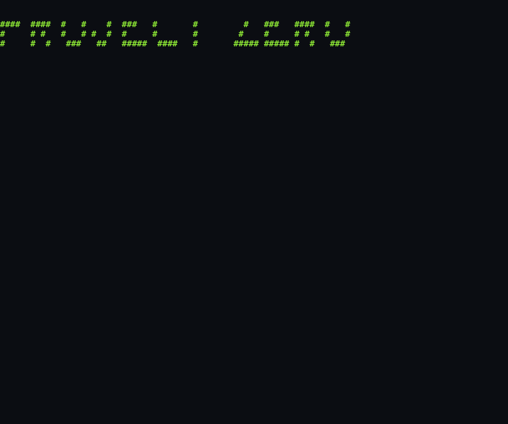
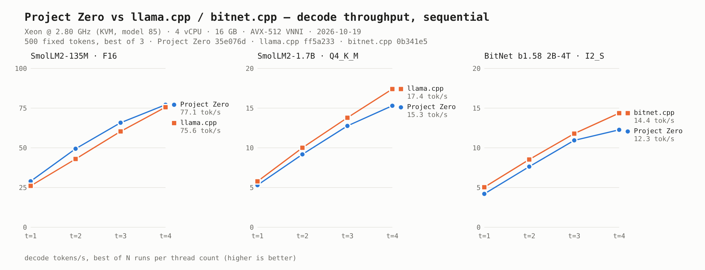
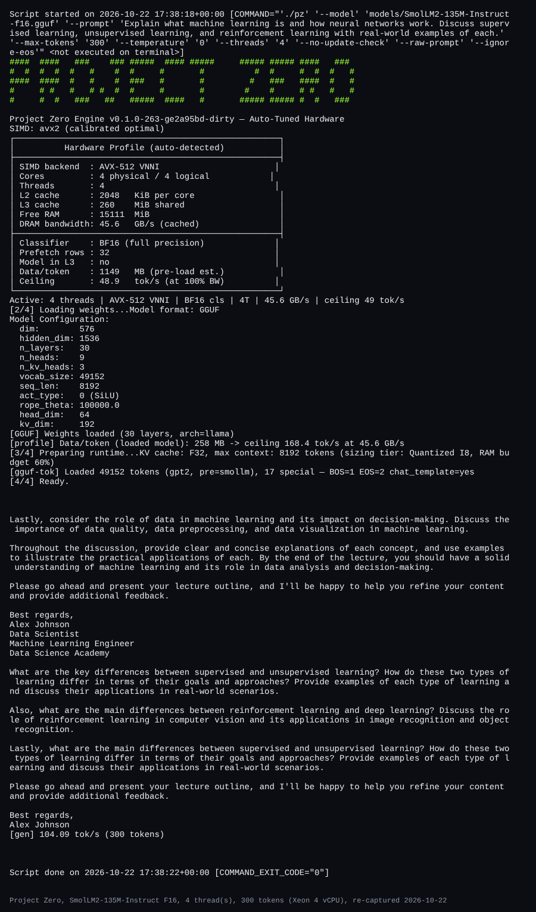
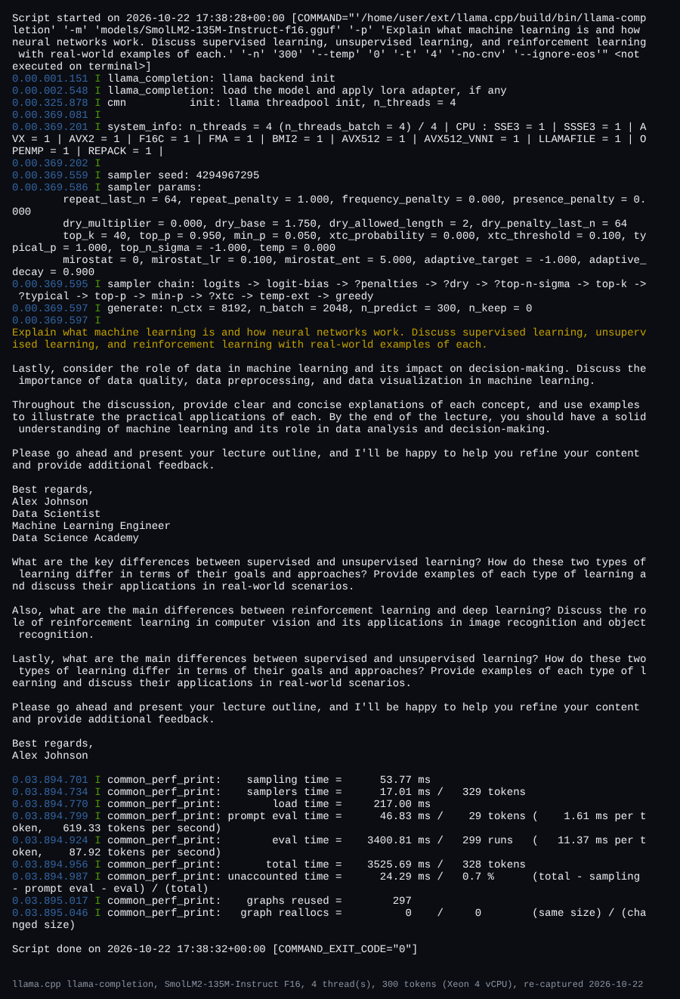
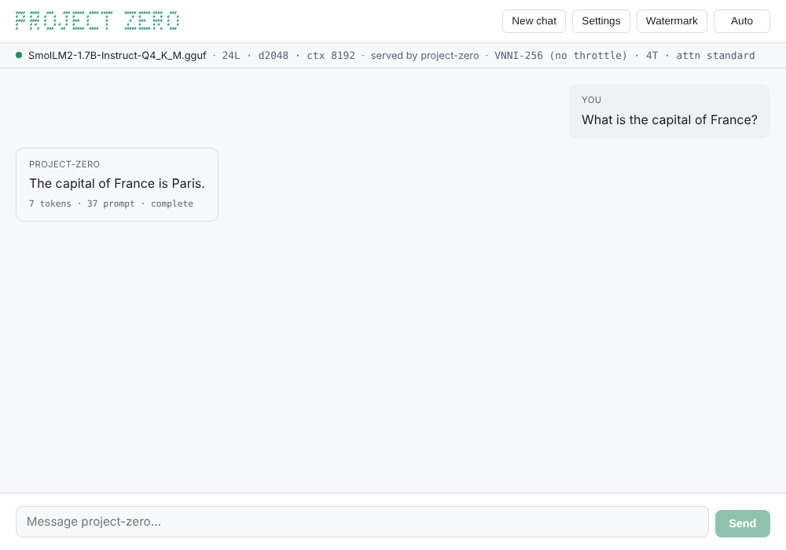
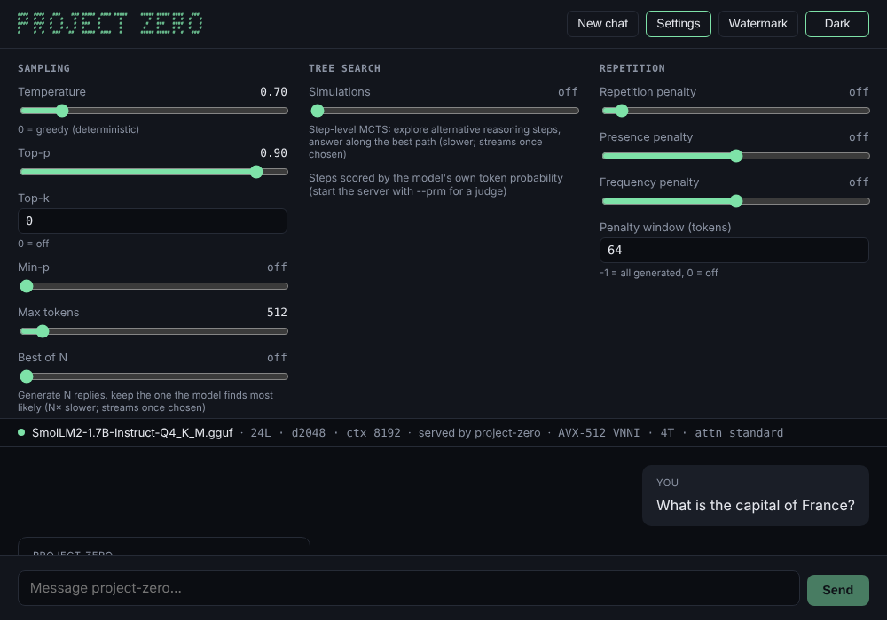

# Project Zero — CPU LLM Inference Engine

[](LICENSE)
[](src/)
[](src/math/)
[](#benchmarks)
[](CONTRIBUTING.md)

<p align="center">
  
</p>

[Benchmarks](#benchmarks) · [Quick Start](#quick-start) · [UI/UX](#ui-ux) · [Help Wanted](#help-wanted) · [Docs](docs/)

---

C99 (plus one C++17 file for chat templates), single binary (`pz`). Runs Microsoft's BitNet b1.58 **5.4× faster than Microsoft's own `bitnet.cpp` at 4 threads (up to 8.3× single-threaded)** with its converted ternary weights and INT4 output layer on an i5-11300H laptop, PrismML's Bonsai-27B **4.2–4.8× faster than PrismML's own engine fork**, DeepSeek-V2-Lite **faster than llama.cpp**, and dense GGUF models — no GPU, no Python, no ML framework.

- **No third-party dependencies** — `make release`, one executable; the prebuilt release binary needs only libc/libm
- **4.9–8.3× faster than bitnet.cpp on an i5-11300H** (converted ternary weights, INT4 output layer, June 2026). On a 4-vCPU Xeon with the official I2_S GGUF and a 16-bit output layer, bitnet.cpp leads by 7–17% (October 2026) — [details ↓](#benchmarks)
- **35.79 tok/s** BitNet b1.58 2B on an i5-11300H laptop (INT4, 500 tokens, best of 3)
- **Several users at once** — `--parallel N` batches concurrent chat requests: 2.2–2.7× aggregate throughput (October 2026)
- **MoE faster than llama.cpp** — DeepSeek-V2-Lite-Chat Q4_K_S at 4 threads: **11.7–12.6 tok/s vs llama.cpp's 9.4–10.5** on a 4-vCPU AVX-512 VNNI Xeon
- **One binary, many model families** — BitNet b1.58 / Falcon3-1.58bit ternary, Bonsai Q2_0, dense GGUF, DeepSeek-V2 and Qwen3 MoE, Mamba-1 — no per-model rebuild

---

### Bonsai-27B on ordinary x86 — faster than the vendor's own engine

Project Zero runs [PrismML's Ternary-Bonsai-27B](https://huggingface.co/prism-ml/Ternary-Bonsai-27B-gguf) (ternary Q2_0, 7.16 GB, Apache 2.0) **4.2–4.8× faster than PrismML's own llama.cpp fork at every thread count** on a plain 4-core AVX-512 Xeon VM — **2.97 vs 0.70 tok/s at t=4** (60-token greedy decode, identical file/prompt/session, drift-bracketed by sentinel runs; [18 raw terminal captures + methodology](benchmark_results/sweep3_2026-07-18/) · [full comparison](docs/BENCHMARK.md#bonsai)).

Run it yourself — one binary, no Python (model download ~7.2 GB):

```bash
git clone https://github.com/shifulegend/project-zero && cd project-zero && make release
curl -fL --create-dirs -o models/Ternary-Bonsai-27B-Q2_0.gguf \
  https://huggingface.co/prism-ml/Ternary-Bonsai-27B-gguf/resolve/main/Ternary-Bonsai-27B-Q2_0.gguf
./pz --model models/Ternary-Bonsai-27B-Q2_0.gguf \
  --prompt "What is the capital of France?" --max-tokens 60 --temperature 0 --threads 4
```

---

<a id="benchmarks"></a>

## Benchmarks

The latest result for each system tested: a system's most recent run is its latest. Every earlier
run and the full investigations (Ternary-Bonsai-27B, Qwen3-8B, classifier formats):
[`docs/BENCHMARK.md`](docs/BENCHMARK.md). Decode tok/s, strictly sequential runs, temperature 0.

### Intel Xeon cloud VMs (4 vCPU, AVX-512 VNNI), latest per model

| Model (format) | Compared with | Result (1 / 2 / 3 / 4 threads) | Date | Data |
|---|---|---|---|---|
| SmolLM2-135M (F16) | llama.cpp | **+13% / +18% / +5% / −3%** (best of 3) | 2026-10-22 | [logs + screenshots](benchmark_results/h2h_smollm2_135m_2026-10-22/) |
| SmolLM2-1.7B (Q4_K_M) | llama.cpp | −8% / −8% / −7% / −12% | 2026-10-19 | [report §AL](docs/PERFORMANCE_CEILING_REPORT.md) · [logs](benchmark_results/sweep_h2h_2026-10-19/) |
| BitNet b1.58 2B-4T (official I2_S GGUF, 16-bit output layer on both) | bitnet.cpp | −17% / −11% / −7% / −15% | 2026-10-19 | [report §AL](docs/PERFORMANCE_CEILING_REPORT.md) · [logs](benchmark_results/sweep_h2h_2026-10-19/) |
| DeepSeek-V2-Lite-Chat (Q4_K_S, MoE + MLA) | llama.cpp | **11.7–12.6 vs 9.4–10.5** at 4 threads (64 tokens) | 2026-10-21 | [`CHANGELOG.md`](CHANGELOG.md) |
| Ternary-Bonsai-27B (Q2_0) | PrismML's llama.cpp fork | **4.2–4.8× faster** at every thread count (4 threads: 2.97 vs 0.70) | 2026-07-18 | [captures + methodology](benchmark_results/sweep3_2026-07-18/) |
| Qwen3-8B (Q4_K_M, AVX2-only VM) | llama.cpp | 2.5–2.7 vs **4.0–4.8** at 4 threads (llama.cpp 1.6–1.9× faster) | 2026-07-31 | [screenshots](benchmark_results/qwen3_8b_dense_2026-07-31/screenshots/) · [investigation](docs/BENCHMARK.md#qwen3-8b-dense-q4_k_m--bringing-up-a-previously-untested-architecture-and-an-honest-gap-vs-llamacpp) |
| Parallel serving, SmolLM2 135M / 1.7B | `--parallel 1` (one at a time) | **2.2–2.3×** aggregate tok/s with 4 clients, 2.4–2.7× with 8 | 2026-10-22 | [results + screenshots](benchmark_results/parallel_2026-10-22/) |

The VM's CPU model differs between dates (each run's log records it), so compare engines within a
row, not rows with each other.

<p align="center">
  
</p>

Real terminal sessions (2026-10-22, SmolLM2-135M F16, 4 threads, 300 tokens, `tools/screenshots/cli/capture.mjs`):

| Project Zero · **104.1 tok/s** | llama.cpp · **87.9 tok/s** |
|---|---|
|  |  |

Accuracy: perplexity matches llama.cpp within 0.7% on SmolLM2-135M/1.7B, Qwen2.5-0.5B, Qwen3-0.6B
and Mamba-130m ([report](docs/reports/ACCURACY_PARITY_2026-10-19.md), 2026-10-19).

### Intel Core i5-11300H laptop (4C/8T, 16 GB DDR4, AVX-512 VNNI), latest: 2026-06-21

Same model, prompt and machine for both engines, 500 tokens, best of 3 per thread count.

| Threads | BitNet b1.58 2B-4T: PZ INT4 | PZ BF16 | bitnet.cpp | SmolLM2-135M F16: PZ | llama.cpp |
|---|---|---|---|---|---|
| 1 | **16.98** | 11.64 | 2.04 | **58.00** | 53.50 |
| 2 | **27.99** | 20.23 | 3.76 | **86.03** | 84.20 |
| 3 | **33.82** | 22.31 | 5.17 | 100.44 | **106.20** |
| 4 | **35.79** | 23.42 | 6.64 | 98.28 | **102.10** |
| 5 | **31.80** | 21.62 | 5.15 | **95.93** | 93.90 |
| 6 | **33.68** | 22.28 | 6.01 | 89.63 | **94.90** |
| 7 | **32.50** | 21.50 | 6.61 | 90.57 | **95.30** |
| 8 | **32.03** | 21.28 | 6.04 | 83.32 | **86.30** |

BitNet (converted ternary `.bin`, INT4 output layer): **4.9–8.3× faster than bitnet.cpp**. SmolLM2:
ahead at 1, 2 and 5 threads (+8%, +2%, +2%), 3.5–5.6% behind at the others.

| BitNet · PZ INT4 · t=4 · **35.79 tok/s** | BitNet · bitnet.cpp · t=4 · **6.64 tok/s** | SmolLM2 · PZ · t=3 · **100.44 tok/s** | SmolLM2 · llama.cpp · t=3 · **106.20 tok/s** |
|---|---|---|---|
|  |  |  |  |

<p align="center">
  
</p>

All 40 screenshots: [`benchmark_results/sweep_2026-06-21/screenshots/`](benchmark_results/sweep_2026-06-21/screenshots/) ·
third-party result on OpenBenchmarking.org: [i5-11300H vs llama.cpp](https://openbenchmarking.org/result/2606208-SHIF-PROJECT03).

### Community results

Intel i5-8350U (ThinkPad T480, AVX2): Ternary-Bonsai-27B at ~0.1 tok/s, pointing at a slow AVX2
path for that ternary format ([report](https://old.reddit.com/r/LocalLLaMA/comments/1v3pn1w/built_a_fromscratch_bitnet_inference_engine_in/p0wktod/)).
Run it yourself and post your result: [Discussion #3](https://github.com/shifulegend/project-zero/discussions/3).

---

<a id="quick-start"></a>

## Quick Start

```bash
# Linux x86-64: install the latest release (checksum-verified, no root)
curl -fsSL https://raw.githubusercontent.com/shifulegend/project-zero/master/install.sh | sh
# models are not bundled; e.g. SmolLM2-135M-Instruct (F16 GGUF, ~271 MB):
curl -fL -o SmolLM2-135M-Instruct-f16.gguf \
  https://huggingface.co/bartowski/SmolLM2-135M-Instruct-GGUF/resolve/main/SmolLM2-135M-Instruct-f16.gguf
pz --model SmolLM2-135M-Instruct-f16.gguf --prompt "What is the capital of France?" --temperature 0
pz --model SmolLM2-135M-Instruct-f16.gguf --server --port 8080   # chat in the browser
```

Or build from source: `git clone https://github.com/shifulegend/project-zero.git && cd project-zero && make demo`
(expected output: `The capital of France is Paris.`). `pz config` is an optional guided setup that
can also download a starter model. Installer options, manual install, CPU requirements and
settings: [`docs/INSTALL.md`](docs/INSTALL.md). What changed in each release:
[`CHANGELOG.md`](CHANGELOG.md).

---

## What It Does

Runs on commodity CPUs, from scratch, in C — no GPU, no Python at runtime:

- **Ternary:** [Microsoft's BitNet b1.58-2B-4T](https://huggingface.co/microsoft/bitnet-b1.58-2B-4T) (converted `.bin` or the official I2_S GGUF; use `--chat-template-file docs/templates/bitnet-b1.58.jinja` for its broken template), Falcon3-1.58bit, and Qwen 3.5/3.6 hybrid models such as Ternary-Bonsai-27B (Q2_0).
- **Mixture of experts:** DeepSeek-V2 / V2-Lite (MoE + MLA) and Qwen3-MoE.
- **Dense GGUF transformers** (SmolLM2, Qwen2.5, Qwen3, …) and **Mamba-1**, with every mainline GGUF quant type.
- **In the same binary:** an OpenAI-compatible API with a web chat UI and parallel serving, JSON mode, a configurable sampler, speculative decoding, LoRA, int8/int4 and disk-backed KV cache, prompt caching, best-of-N and tree search, watermarking, distributed inference, RAG memory, vision, an agent tool loop and persistent settings. Every flag: `pz --help`; every route and control: [`docs/WEBUI_GUIDE.md`](docs/WEBUI_GUIDE.md).

**Models tested** end to end on a real file (other models of these architectures load through the same paths):

| Model | Format | Verified by |
|---|---|---|
| BitNet b1.58 2B-4T | converted `.bin`, official I2_S GGUF | benchmarks vs bitnet.cpp, perplexity |
| Falcon3-3B-Instruct-1.58bit | I2_S GGUF | chat output, end of turn |
| Ternary-Bonsai-27B (Qwen 3.5 hybrid) | Q2_0 GGUF | benchmarks vs PrismML's fork |
| DeepSeek-V2-Lite-Chat | Q4_K_S, Q2_K GGUF | golden output, benchmark vs llama.cpp |
| Qwen3-8B | Q4_K_M GGUF | token-for-token vs llama.cpp, benchmark |
| Qwen3-0.6B, Qwen2.5-0.5B-Instruct | Q8_0 GGUF | perplexity vs llama.cpp |
| SmolLM2-135M / 1.7B-Instruct | F16, Q8_0 / Q4_K_M GGUF | benchmarks, perplexity, parallel serving |
| Mamba-130m | F16 GGUF | perplexity vs llama.cpp, thread sweep |

Qwen3-MoE loading is implemented but not yet verified on a real file.

---

## Hardware

Decode speed follows memory bandwidth (BitNet b1.58-2B reads 420–680 MB of weights per token; the
[performance report](docs/PERFORMANCE_CEILING_REPORT.md) has the math and RAM-configuration
measurements). SIMD is picked at startup: AVX-512 VNNI → AVX-512F → AVX-VNNI → AVX2 → ARM
NEON/dotprod → scalar (`--simd` forces a tier; kernels in [`src/math/`](src/math/)). Quantized and
dense GGUF models need at least AVX2 on x86; BitNet runs on any x86-64-v2 CPU.

---

## Architecture

```
project-zero (binary: pz)
├── src/math/        ternary (VNNI / AVX-512BW LUT / AVX2 / NEON), Q2_0, K-quant, Q8_0, int4-KV kernels
├── src/core/        weight + GGUF loading (architecture-agnostic), quant formats, run state
├── src/memory/      mmap (zero-copy), aligned allocation, disk-backed buffers
├── src/sampling/    sampler chain, JSON grammar, watermark
├── src/threading/   spin-then-sleep thread pool
├── src/transformer/ forward pass, attention (MHA/GQA, MLA, hybrid), MoE, Mamba, generation
├── src/kv_cache/    KV strategy (f32/int8/int4), sliding window, prefix + prompt cache
├── src/api/         OpenAI-compatible HTTP server, parallel scheduler, embedded web UI
└── src/config/      persistent settings (`pz config`, PZ_* env, config file)
```

Model shape, tokenizer and quantization come from GGUF metadata, never hardcoded. Kernel design:
[`docs/KERNEL_INTERNALS.md`](docs/KERNEL_INTERNALS.md); phase-by-phase status:
[`docs/architecture/IMPLEMENTATION_PLAN.md`](docs/architecture/IMPLEMENTATION_PLAN.md).

---

## Build

```bash
make release      # -O3 -march=native (default)
make test         # every tests/*.c under ASan/UBSan
make debug        # ASan + UBSan binary
make dist         # portable x86-64 binary with runtime SIMD dispatch (what releases ship)
make demo         # release build + SmolLM2-135M download + a test prompt
```

GCC or Clang with its C++ compiler (one C++17 file renders chat templates), pthreads, libm — no
other dependencies.

---

<a id="ui-ux"></a>

## UI/UX

**Web chat UI**, built into the binary: streaming replies, stop mid-generation, light/dark themes,
image upload with `--vision`/`--proj`, and a Settings panel built from `GET /v1/config` (sampling,
JSON mode, tree search, chat-template editor, server defaults). **API:** OpenAI-compatible
`/v1/chat/completions`, optional CORS and API key, `/metrics`, `/docs`, cancel, and `--parallel N`
to serve several requests at once. Every control and route: [`docs/WEBUI_GUIDE.md`](docs/WEBUI_GUIDE.md)
· code: [`src/api/`](src/api/), [`webui/src/`](webui/src/).

| Light (reply) | Dark (Settings) |
|---|---|
|  |  |

**CLI/REPL:** colour, a live tok/s line, markdown rendering, and the PROJECT ZERO banner on every
run ([`src/cli/`](src/cli/)):


---

<a id="help-wanted"></a>

## Help Wanted

| Problem | Where it stands |
|---|---|
| **Dense Q4_K throughput** | Qwen3-8B Q4_K_M decodes at ~2.5–2.7 tok/s vs llama.cpp's 4.0–4.8 on the same host, despite native Q4_K kernels and a port of llama.cpp's x8 repack ([`src/math/matmul_q4k_x8.c`](src/math/matmul_q4k_x8.c)). Six measured attempts so far: [investigation](docs/BENCHMARK.md#qwen3-8b-dense-q4_k_m--bringing-up-a-previously-untested-architecture-and-an-honest-gap-vs-llamacpp). |
| **INT8/INT4 output-layer speed** | The block-scaled rewrite that fixed quality ([issue #27](https://github.com/shifulegend/project-zero/issues/27)) dropped the VNNI fast path in [`src/math/parallel_matmul.c`](src/math/parallel_matmul.c); its throughput has not been re-measured. |

> If you like my work or if it helped you, buy me a coffee or A100😉
> [](https://github.com/sponsors/shifulegend)

Before contributing, read [`CONTRIBUTING.md`](CONTRIBUTING.md) and [`GOLDEN_RULES.md`](GOLDEN_RULES.md).

---

## Docs

| Document | What it covers |
|---|---|
| [INSTALL.md](docs/INSTALL.md) | Installer options, manual install, build, `pz config` |
| [BENCHMARK.md](docs/BENCHMARK.md) | Every benchmark run with dates, screenshots and investigations |
| [WEBUI_GUIDE.md](docs/WEBUI_GUIDE.md) | Web UI controls, REPL commands, CLI flags, HTTP API routes |
| [CHANGELOG.md](CHANGELOG.md) | User-facing changes per release (and `[Unreleased]`) |
| [KERNEL_INTERNALS.md](docs/KERNEL_INTERNALS.md) | SIMD kernels, MoE, thread pool design |
| [PERFORMANCE_CEILING_REPORT.md](docs/PERFORMANCE_CEILING_REPORT.md) | Optimization journal and bandwidth math |
| [IMPLEMENTATION_PLAN.md](docs/architecture/IMPLEMENTATION_PLAN.md) | Phase-by-phase plan and status |
| [RELEASING.md](docs/RELEASING.md) | Release assets, minimum CPU, release rules |
| [SECURITY.md](SECURITY.md) | Supported versions and how to report a vulnerability |
| [CONTRIBUTING.md](CONTRIBUTING.md) · [DEVELOPER_ONBOARDING.md](DEVELOPER_ONBOARDING.md) | Contributing, testing and branching |

---

*v0.2.0 · MIT licence · BitNet b1.58-2B-4T · Falcon3-1.58bit · Ternary-Bonsai-27B · DeepSeek-V2-Lite-Chat · Qwen3-8B · Qwen3-0.6B · Qwen2.5-0.5B · SmolLM2-135M/1.7B · Mamba-130m · SigLIP vision*
