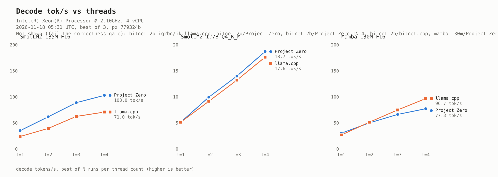

# Head-to-head decode benchmark

UTC start: 2026-11-18T14:18:27Z  |  host: Intel(R) Xeon(R) Processor @ 2.10GHz  |  pz commit: 779324b

| model | variant | threads | runs | best tok/s | mean tok/s | stdev | mean / reference | gate |
|---|---|---|---|---|---|---|---|---|
| bitnet-2b | bitnetcpp | 1 | 3 | n/a | n/a | n/a | n/a | INVALID |
| bitnet-2b | pz | 1 | 3 | n/a | n/a | n/a | n/a | INVALID |
| bitnet-2b | pz-int4 | 1 | 3 | n/a | n/a | n/a | n/a | INVALID |
| bitnet-2b | bitnetcpp | 2 | 3 | n/a | n/a | n/a | n/a | INVALID |
| bitnet-2b | pz | 2 | 3 | n/a | n/a | n/a | n/a | INVALID |
| bitnet-2b | pz-int4 | 2 | 3 | n/a | n/a | n/a | n/a | INVALID |
| bitnet-2b | bitnetcpp | 3 | 3 | n/a | n/a | n/a | n/a | INVALID |
| bitnet-2b | pz | 3 | 3 | n/a | n/a | n/a | n/a | INVALID |
| bitnet-2b | pz-int4 | 3 | 3 | n/a | n/a | n/a | n/a | INVALID |
| bitnet-2b | bitnetcpp | 4 | 3 | n/a | n/a | n/a | n/a | INVALID |
| bitnet-2b | pz | 4 | 3 | n/a | n/a | n/a | n/a | INVALID |
| bitnet-2b | pz-int4 | 4 | 3 | n/a | n/a | n/a | n/a | INVALID |
| bitnet-2b-iq2bn | ik | 1 | 3 | n/a | n/a | n/a | n/a | INVALID |
| bitnet-2b-iq2bn | ik | 2 | 3 | n/a | n/a | n/a | n/a | INVALID |
| bitnet-2b-iq2bn | ik | 3 | 3 | n/a | n/a | n/a | n/a | INVALID |
| bitnet-2b-iq2bn | ik | 4 | 3 | n/a | n/a | n/a | n/a | INVALID |
| mamba-130m | llamacpp | 1 | 3 | 26.94 | 26.77 | 0.14 | 90% | REF |
| mamba-130m | pz | 1 | 3 | 30.29 | 29.87 | 0.72 | 100% | PASS |
| mamba-130m | pz-int4 | 1 | 3 | n/a | n/a | n/a | n/a | INVALID |
| mamba-130m | llamacpp | 2 | 3 | 51.53 | 50.44 | 1.64 | 103% | REF |
| mamba-130m | pz | 2 | 3 | 50.18 | 48.99 | 1.06 | 100% | PASS |
| mamba-130m | pz-int4 | 2 | 3 | n/a | n/a | n/a | n/a | INVALID |
| mamba-130m | llamacpp | 3 | 3 | 74.89 | 71.46 | 3.30 | 113% | REF |
| mamba-130m | pz | 3 | 3 | 66.33 | 63.31 | 2.62 | 100% | PASS |
| mamba-130m | pz-int4 | 3 | 3 | n/a | n/a | n/a | n/a | INVALID |
| mamba-130m | llamacpp | 4 | 3 | 96.74 | 93.95 | 2.58 | 125% | REF |
| mamba-130m | pz | 4 | 3 | 77.29 | 74.90 | 3.96 | 100% | PASS |
| mamba-130m | pz-int4 | 4 | 3 | n/a | n/a | n/a | n/a | INVALID |
| smollm2-1.7b-q4km | ik | 1 | 3 | n/a | n/a | n/a | n/a | INVALID |
| smollm2-1.7b-q4km | llamacpp | 1 | 3 | 5.15 | 4.99 | 0.17 | 100% | REF |
| smollm2-1.7b-q4km | pz | 1 | 3 | 5.15 | 4.97 | 0.16 | 100% | PASS |
| smollm2-1.7b-q4km | pz-int4 | 1 | 3 | n/a | n/a | n/a | n/a | INVALID |
| smollm2-1.7b-q4km | ik | 2 | 3 | n/a | n/a | n/a | n/a | INVALID |
| smollm2-1.7b-q4km | llamacpp | 2 | 3 | 9.16 | 8.90 | 0.25 | 93% | REF |
| smollm2-1.7b-q4km | pz | 2 | 3 | 9.96 | 9.54 | 0.37 | 100% | PASS |
| smollm2-1.7b-q4km | pz-int4 | 2 | 3 | n/a | n/a | n/a | n/a | INVALID |
| smollm2-1.7b-q4km | ik | 3 | 3 | n/a | n/a | n/a | n/a | INVALID |
| smollm2-1.7b-q4km | llamacpp | 3 | 3 | 13.23 | 13.03 | 0.24 | 94% | REF |
| smollm2-1.7b-q4km | pz | 3 | 3 | 14.01 | 13.80 | 0.26 | 100% | PASS |
| smollm2-1.7b-q4km | pz-int4 | 3 | 3 | n/a | n/a | n/a | n/a | INVALID |
| smollm2-1.7b-q4km | ik | 4 | 3 | n/a | n/a | n/a | n/a | INVALID |
| smollm2-1.7b-q4km | llamacpp | 4 | 3 | 17.63 | 17.13 | 0.47 | 97% | REF |
| smollm2-1.7b-q4km | pz | 4 | 3 | 18.71 | 17.72 | 0.85 | 100% | PASS |
| smollm2-1.7b-q4km | pz-int4 | 4 | 3 | n/a | n/a | n/a | n/a | INVALID |
| smollm2-135m | ik | 1 | 3 | n/a | n/a | n/a | n/a | INVALID |
| smollm2-135m | llamacpp | 1 | 3 | 23.89 | 22.91 | 0.87 | 73% | REF |
| smollm2-135m | pz | 1 | 3 | 35.14 | 31.38 | 3.28 | 100% | PASS |
| smollm2-135m | pz-int4 | 1 | 3 | n/a | n/a | n/a | n/a | INVALID |
| smollm2-135m | ik | 2 | 3 | n/a | n/a | n/a | n/a | INVALID |
| smollm2-135m | llamacpp | 2 | 3 | 39.47 | 39.17 | 0.43 | 67% | REF |
| smollm2-135m | pz | 2 | 3 | 61.88 | 58.54 | 3.80 | 100% | PASS |
| smollm2-135m | pz-int4 | 2 | 3 | n/a | n/a | n/a | n/a | INVALID |
| smollm2-135m | ik | 3 | 3 | n/a | n/a | n/a | n/a | INVALID |
| smollm2-135m | llamacpp | 3 | 3 | 62.53 | 59.26 | 3.41 | 71% | REF |
| smollm2-135m | pz | 3 | 3 | 88.90 | 83.16 | 6.58 | 100% | PASS |
| smollm2-135m | pz-int4 | 3 | 3 | n/a | n/a | n/a | n/a | INVALID |
| smollm2-135m | ik | 4 | 3 | n/a | n/a | n/a | n/a | INVALID |
| smollm2-135m | llamacpp | 4 | 3 | 70.96 | 69.67 | 1.33 | 68% | REF |
| smollm2-135m | pz | 4 | 3 | 103.03 | 102.49 | 0.54 | 100% | PASS |
| smollm2-135m | pz-int4 | 4 | 3 | n/a | n/a | n/a | n/a | INVALID |

## Correctness gate

Mode strict; tolerance 1.0 % (WARN up to 2.0x); text `gate_text.txt` (sha256 8512a15e3523), 8 chunks of 512.

| model | variant | ppl | reference ppl | delta | smoke | verdict |
|---|---|---|---|---|---|---|
| bitnet-2b-iq2bn | ik | - | 31.3344 | - | ok | INVALID |
| bitnet-2b | bitnetcpp | 48.6683 | - | - | WRONG | INVALID |
| bitnet-2b | bitnetcpp-fix (modified) | 31.3344 | - | +0.00 % | ok | REF |
| bitnet-2b | pz | 34.3926 | 31.3344 | +9.76 % | ok | INVALID |
| bitnet-2b | pz-int4 | 35.6045 | 31.3344 | +13.63 % | ok | INVALID |
| mamba-130m | llamacpp | 12.5667 | - | +0.00 % | ok | REF |
| mamba-130m | pz | 12.5801 | 12.5667 | +0.11 % | ok | PASS |
| mamba-130m | pz-int4 | 84.8103 | - | - | WRONG | INVALID |
| smollm2-1.7b-q4km | ik | - | 5.9495 | - | ok | INVALID |
| smollm2-1.7b-q4km | llamacpp | 5.9495 | - | +0.00 % | ok | REF |
| smollm2-1.7b-q4km | pz | 5.9221 | 5.9495 | -0.46 % | ok | PASS |
| smollm2-1.7b-q4km | pz-int4 | 6.3295 | 5.9495 | +6.39 % | ok | INVALID |
| smollm2-135m | ik | - | 8.0257 | - | ok | INVALID |
| smollm2-135m | llamacpp | 8.0257 | - | +0.00 % | ok | REF |
| smollm2-135m | pz | 8.0252 | 8.0257 | -0.01 % | ok | PASS |
| smollm2-135m | pz-int4 | 9.3956 | 8.0257 | +17.07 % | ok | INVALID |

## Screenshots

| model | variant | threads | screenshot |
|---|---|---|---|
| smollm2-135m | pz | 1 | benchmark_results/h2h_20261118-053147Z_published-sweep/screenshots/20261118-083611Z_smollm2-135m__pz_t1.png |
| smollm2-135m | pz-int4 | 1 | benchmark_results/h2h_20261118-053147Z_published-sweep/screenshots/20261118-083635Z_smollm2-135m__pz-int4_t1.png |
| smollm2-135m | llamacpp | 1 | benchmark_results/h2h_20261118-053147Z_published-sweep/screenshots/20261118-083654Z_smollm2-135m__llamacpp_t1.png |
| smollm2-135m | ik | 1 | benchmark_results/h2h_20261118-053147Z_published-sweep/screenshots/20261118-083717Z_smollm2-135m__ik_t1.png |
| smollm2-1.7b-q4km | pz | 1 | benchmark_results/h2h_20261118-053147Z_published-sweep/screenshots/20261118-083737Z_smollm2-1.7b-q4km__pz_t1.png |
| smollm2-1.7b-q4km | pz-int4 | 1 | benchmark_results/h2h_20261118-053147Z_published-sweep/screenshots/20261118-083931Z_smollm2-1.7b-q4km__pz-int4_t1.png |
| smollm2-1.7b-q4km | llamacpp | 1 | benchmark_results/h2h_20261118-053147Z_published-sweep/screenshots/20261118-084123Z_smollm2-1.7b-q4km__llamacpp_t1.png |
| smollm2-1.7b-q4km | ik | 1 | benchmark_results/h2h_20261118-053147Z_published-sweep/screenshots/20261118-084309Z_smollm2-1.7b-q4km__ik_t1.png |
| bitnet-2b | pz | 1 | benchmark_results/h2h_20261118-053147Z_published-sweep/screenshots/20261118-084439Z_bitnet-2b__pz_t1.png |
| bitnet-2b | pz-int4 | 1 | benchmark_results/h2h_20261118-053147Z_published-sweep/screenshots/20261118-084603Z_bitnet-2b__pz-int4_t1.png |
| bitnet-2b | bitnetcpp | 1 | benchmark_results/h2h_20261118-053147Z_published-sweep/screenshots/20261118-084722Z_bitnet-2b__bitnetcpp_t1.png |
| bitnet-2b-iq2bn | ik | 1 | benchmark_results/h2h_20261118-053147Z_published-sweep/screenshots/20261118-084858Z_bitnet-2b-iq2bn__ik_t1.png |
| mamba-130m | pz | 1 | benchmark_results/h2h_20261118-053147Z_published-sweep/screenshots/20261118-085033Z_mamba-130m__pz_t1.png |
| mamba-130m | pz-int4 | 1 | benchmark_results/h2h_20261118-053147Z_published-sweep/screenshots/20261118-085056Z_mamba-130m__pz-int4_t1.png |
| mamba-130m | llamacpp | 1 | benchmark_results/h2h_20261118-053147Z_published-sweep/screenshots/20261118-085118Z_mamba-130m__llamacpp_t1.png |
| smollm2-135m | pz | 2 | benchmark_results/h2h_20261118-053147Z_published-sweep/screenshots/20261118-085139Z_smollm2-135m__pz_t2.png |
| smollm2-135m | pz-int4 | 2 | benchmark_results/h2h_20261118-053147Z_published-sweep/screenshots/20261118-085151Z_smollm2-135m__pz-int4_t2.png |
| smollm2-135m | llamacpp | 2 | benchmark_results/h2h_20261118-053147Z_published-sweep/screenshots/20261118-085202Z_smollm2-135m__llamacpp_t2.png |
| smollm2-135m | ik | 2 | benchmark_results/h2h_20261118-053147Z_published-sweep/screenshots/20261118-085217Z_smollm2-135m__ik_t2.png |
| smollm2-1.7b-q4km | pz | 2 | benchmark_results/h2h_20261118-053147Z_published-sweep/screenshots/20261118-085230Z_smollm2-1.7b-q4km__pz_t2.png |
| smollm2-1.7b-q4km | pz-int4 | 2 | benchmark_results/h2h_20261118-053147Z_published-sweep/screenshots/20261118-085339Z_smollm2-1.7b-q4km__pz-int4_t2.png |
| smollm2-1.7b-q4km | llamacpp | 2 | benchmark_results/h2h_20261118-053147Z_published-sweep/screenshots/20261118-085451Z_smollm2-1.7b-q4km__llamacpp_t2.png |
| smollm2-1.7b-q4km | ik | 2 | benchmark_results/h2h_20261118-053147Z_published-sweep/screenshots/20261118-085559Z_smollm2-1.7b-q4km__ik_t2.png |
| bitnet-2b | pz | 2 | benchmark_results/h2h_20261118-053147Z_published-sweep/screenshots/20261118-085651Z_bitnet-2b__pz_t2.png |
| bitnet-2b | pz-int4 | 2 | benchmark_results/h2h_20261118-053147Z_published-sweep/screenshots/20261118-085747Z_bitnet-2b__pz-int4_t2.png |
| bitnet-2b | bitnetcpp | 2 | benchmark_results/h2h_20261118-053147Z_published-sweep/screenshots/20261118-085838Z_bitnet-2b__bitnetcpp_t2.png |
| bitnet-2b-iq2bn | ik | 2 | benchmark_results/h2h_20261118-053147Z_published-sweep/screenshots/20261118-085933Z_bitnet-2b-iq2bn__ik_t2.png |
| mamba-130m | pz | 2 | benchmark_results/h2h_20261118-053147Z_published-sweep/screenshots/20261118-090023Z_mamba-130m__pz_t2.png |
| mamba-130m | pz-int4 | 2 | benchmark_results/h2h_20261118-053147Z_published-sweep/screenshots/20261118-090037Z_mamba-130m__pz-int4_t2.png |
| mamba-130m | llamacpp | 2 | benchmark_results/h2h_20261118-053147Z_published-sweep/screenshots/20261118-090051Z_mamba-130m__llamacpp_t2.png |
| smollm2-135m | pz | 3 | benchmark_results/h2h_20261118-053147Z_published-sweep/screenshots/20261118-090105Z_smollm2-135m__pz_t3.png |
| smollm2-135m | pz-int4 | 3 | benchmark_results/h2h_20261118-053147Z_published-sweep/screenshots/20261118-090114Z_smollm2-135m__pz-int4_t3.png |
| smollm2-135m | llamacpp | 3 | benchmark_results/h2h_20261118-053147Z_published-sweep/screenshots/20261118-090125Z_smollm2-135m__llamacpp_t3.png |
| smollm2-135m | ik | 3 | benchmark_results/h2h_20261118-053147Z_published-sweep/screenshots/20261118-090136Z_smollm2-135m__ik_t3.png |
| smollm2-1.7b-q4km | pz | 3 | benchmark_results/h2h_20261118-053147Z_published-sweep/screenshots/20261118-090145Z_smollm2-1.7b-q4km__pz_t3.png |
| smollm2-1.7b-q4km | pz-int4 | 3 | benchmark_results/h2h_20261118-053147Z_published-sweep/screenshots/20261118-090233Z_smollm2-1.7b-q4km__pz-int4_t3.png |
| smollm2-1.7b-q4km | llamacpp | 3 | benchmark_results/h2h_20261118-053147Z_published-sweep/screenshots/20261118-090322Z_smollm2-1.7b-q4km__llamacpp_t3.png |
| smollm2-1.7b-q4km | ik | 3 | benchmark_results/h2h_20261118-053147Z_published-sweep/screenshots/20261118-090409Z_smollm2-1.7b-q4km__ik_t3.png |
| bitnet-2b | pz | 3 | benchmark_results/h2h_20261118-053147Z_published-sweep/screenshots/20261118-090448Z_bitnet-2b__pz_t3.png |
| bitnet-2b | pz-int4 | 3 | benchmark_results/h2h_20261118-053147Z_published-sweep/screenshots/20261118-090524Z_bitnet-2b__pz-int4_t3.png |
| bitnet-2b | bitnetcpp | 3 | benchmark_results/h2h_20261118-053147Z_published-sweep/screenshots/20261118-090602Z_bitnet-2b__bitnetcpp_t3.png |
| bitnet-2b-iq2bn | ik | 3 | benchmark_results/h2h_20261118-053147Z_published-sweep/screenshots/20261118-090638Z_bitnet-2b-iq2bn__ik_t3.png |
| mamba-130m | pz | 3 | benchmark_results/h2h_20261118-053147Z_published-sweep/screenshots/20261118-090717Z_mamba-130m__pz_t3.png |
| mamba-130m | pz-int4 | 3 | benchmark_results/h2h_20261118-053147Z_published-sweep/screenshots/20261118-090729Z_mamba-130m__pz-int4_t3.png |
| mamba-130m | llamacpp | 3 | benchmark_results/h2h_20261118-053147Z_published-sweep/screenshots/20261118-090741Z_mamba-130m__llamacpp_t3.png |
| smollm2-135m | pz | 4 | benchmark_results/h2h_20261118-053147Z_published-sweep/screenshots/20261118-090751Z_smollm2-135m__pz_t4.png |
| smollm2-135m | pz-int4 | 4 | benchmark_results/h2h_20261118-053147Z_published-sweep/screenshots/20261118-090800Z_smollm2-135m__pz-int4_t4.png |
| smollm2-135m | llamacpp | 4 | benchmark_results/h2h_20261118-053147Z_published-sweep/screenshots/20261118-090809Z_smollm2-135m__llamacpp_t4.png |
| smollm2-135m | ik | 4 | benchmark_results/h2h_20261118-053147Z_published-sweep/screenshots/20261118-090820Z_smollm2-135m__ik_t4.png |
| smollm2-1.7b-q4km | pz | 4 | benchmark_results/h2h_20261118-053147Z_published-sweep/screenshots/20261118-090831Z_smollm2-1.7b-q4km__pz_t4.png |
| smollm2-1.7b-q4km | pz-int4 | 4 | benchmark_results/h2h_20261118-053147Z_published-sweep/screenshots/20261118-090916Z_smollm2-1.7b-q4km__pz-int4_t4.png |
| smollm2-1.7b-q4km | llamacpp | 4 | benchmark_results/h2h_20261118-053147Z_published-sweep/screenshots/20261118-090958Z_smollm2-1.7b-q4km__llamacpp_t4.png |
| smollm2-1.7b-q4km | ik | 4 | benchmark_results/h2h_20261118-053147Z_published-sweep/screenshots/20261118-091037Z_smollm2-1.7b-q4km__ik_t4.png |
| bitnet-2b | pz | 4 | benchmark_results/h2h_20261118-053147Z_published-sweep/screenshots/20261118-091139Z_bitnet-2b__pz_t4.png |
| bitnet-2b | pz-int4 | 4 | benchmark_results/h2h_20261118-053147Z_published-sweep/screenshots/20261118-091212Z_bitnet-2b__pz-int4_t4.png |
| bitnet-2b | bitnetcpp | 4 | benchmark_results/h2h_20261118-053147Z_published-sweep/screenshots/20261118-091246Z_bitnet-2b__bitnetcpp_t4.png |
| bitnet-2b-iq2bn | ik | 4 | benchmark_results/h2h_20261118-053147Z_published-sweep/screenshots/20261118-091319Z_bitnet-2b-iq2bn__ik_t4.png |
| mamba-130m | pz | 4 | benchmark_results/h2h_20261118-053147Z_published-sweep/screenshots/20261118-091354Z_mamba-130m__pz_t4.png |
| mamba-130m | pz-int4 | 4 | benchmark_results/h2h_20261118-053147Z_published-sweep/screenshots/20261118-091405Z_mamba-130m__pz-int4_t4.png |
| mamba-130m | llamacpp | 4 | benchmark_results/h2h_20261118-053147Z_published-sweep/screenshots/20261118-091417Z_mamba-130m__llamacpp_t4.png |

## Chart

