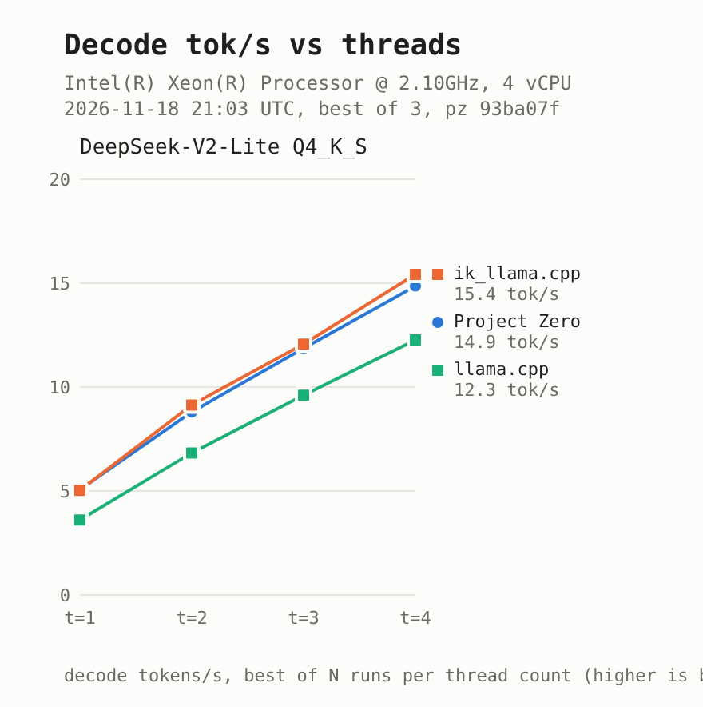

# Head-to-head decode benchmark

UTC start: 2026-11-18T21:03:02Z  |  host: Intel(R) Xeon(R) Processor @ 2.10GHz  |  pz commit: 93ba07f

| model | variant | threads | runs | best tok/s | mean tok/s | stdev | mean / reference | gate |
|---|---|---|---|---|---|---|---|---|
| deepseek-v2-lite | ik | 1 | 3 | 5.03 | 4.88 | 0.14 | 97% | PASS |
| deepseek-v2-lite | llamacpp | 1 | 3 | 3.61 | 3.55 | 0.07 | 71% | REF |
| deepseek-v2-lite | pz | 1 | 3 | 5.06 | 5.02 | 0.04 | 100% | PASS |
| deepseek-v2-lite | ik | 2 | 3 | 9.14 | 8.98 | 0.18 | 102% | PASS |
| deepseek-v2-lite | llamacpp | 2 | 3 | 6.83 | 6.65 | 0.23 | 76% | REF |
| deepseek-v2-lite | pz | 2 | 3 | 8.80 | 8.80 | 0.01 | 100% | PASS |
| deepseek-v2-lite | ik | 3 | 3 | 12.07 | 11.93 | 0.16 | 101% | PASS |
| deepseek-v2-lite | llamacpp | 3 | 3 | 9.61 | 9.25 | 0.31 | 79% | REF |
| deepseek-v2-lite | pz | 3 | 3 | 11.86 | 11.76 | 0.09 | 100% | PASS |
| deepseek-v2-lite | ik | 4 | 3 | 15.42 | 15.10 | 0.40 | 104% | PASS |
| deepseek-v2-lite | llamacpp | 4 | 3 | 12.27 | 11.54 | 0.80 | 79% | REF |
| deepseek-v2-lite | pz | 4 | 3 | 14.86 | 14.56 | 0.40 | 100% | PASS |

## Correctness gate

Mode strict; tolerance 1.0 % (WARN up to 2.0x); text `gate_text.txt` (sha256 8512a15e3523), 8 chunks of 512.

| model | variant | ppl | reference ppl | delta | smoke | verdict | timed |
|---|---|---|---|---|---|---|---|
| deepseek-v2-lite | ik | 6.5933 | 6.6130 | -0.30 % | ok | PASS | yes |
| deepseek-v2-lite | llamacpp | 6.6130 | - | +0.00 % | ok | REF | yes |
| deepseek-v2-lite | pz | 6.6678 | 6.6130 | +0.83 % | ok | PASS | yes |

## Screenshots

| model | variant | threads | screenshot |
|---|---|---|---|
| deepseek-v2-lite | pz | 4 | benchmark_results/h2h_20261118-210302Z_deepseek-refresh/screenshots/20261118-213324Z_deepseek-v2-lite__pz_t4.png |
| deepseek-v2-lite | llamacpp | 4 | benchmark_results/h2h_20261118-210302Z_deepseek-refresh/screenshots/20261118-213345Z_deepseek-v2-lite__llamacpp_t4.png |
| deepseek-v2-lite | ik | 4 | benchmark_results/h2h_20261118-210302Z_deepseek-refresh/screenshots/20261118-213411Z_deepseek-v2-lite__ik_t4.png |

## Chart

