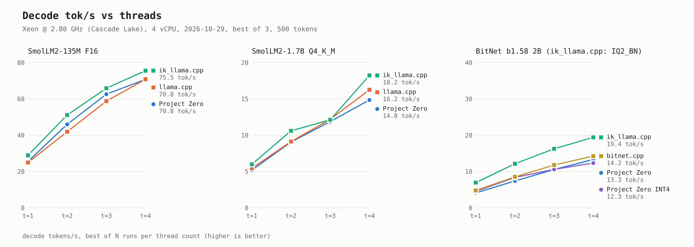
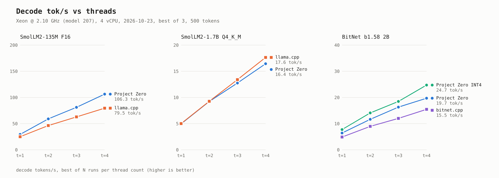

# Benchmarks

Decode speed in tokens per second. Unless a section says otherwise: best of 3 runs per thread
count, 500 generated tokens, temperature 0, one engine at a time with nothing else running. Raw
logs, the exact commands and the host's CPU details are in each linked folder.

## Intel Xeon @ 2.80 GHz (Cascade Lake), 4 vCPU — 2026-10-29

Tok/s at 1 / 2 / 3 / 4 threads. ik_llama.cpp runs with `-rtr`; for BitNet it runs the same
official I2_S GGUF converted to its IQ2_BN format (`llama-quantize --allow-requantize ... iq2_bn`).

| Model | Project Zero | llama.cpp | ik_llama.cpp | bitnet.cpp |
|---|---|---|---|---|
| SmolLM2-135M F16 | 25.6 / 46.0 / 62.6 / 70.8 | 25.0 / 42.0 / 58.8 / 70.8 | **29.0 / 51.1 / 65.9 / 75.5** | – |
| SmolLM2-1.7B Q4_K_M | 5.20 / 9.07 / 11.88 / 14.85 | 5.45 / 9.14 / **12.19** / 16.25 | **6.00 / 10.61** / 12.12 / **18.23** | – |
| BitNet b1.58 2B-4T | 4.11 / 7.42 / 10.55 / 13.32 | – | **6.95 / 12.15 / 16.26 / 19.43** | 4.80 / 8.55 / 11.80 / 14.24 |
| BitNet, Project Zero `--classifier int4` | 4.54 / 8.38 / 10.60 / 12.34 | – | – | – |

DeepSeek-V2-Lite-Chat Q4_K_S, 4 threads, 200 tokens: Project Zero 12.26, llama.cpp 11.48,
ik_llama.cpp **14.16**. llama.cpp and ik_llama.cpp run with `-c 1024`: their default is the
model's full 160K context, whose KV cache does not fit in this machine's 15 GB.

Data and 4-thread screenshots: [sweep](../benchmark_results/sweep_h2h_2026-10-29/) ·
[DeepSeek](../benchmark_results/deepseek_h2h_2026-10-29/). The 2026-10-19 run on this machine:
[benchmark_results/sweep_h2h_2026-10-19/](../benchmark_results/sweep_h2h_2026-10-19/).

## Intel Xeon @ 2.10 GHz (model 207, AVX-512 BF16), 4 vCPU — 2026-10-23

| Model | Project Zero, 1 / 2 / 3 / 4 threads | Compared with | Difference |
|---|---|---|---|
| SmolLM2-135M F16 | 29.4 / 59.0 / 81.2 / 106.3 | llama.cpp: 25.0 / 46.3 / 62.9 / 79.5 | 18–34% faster |
| SmolLM2-1.7B Q4_K_M | 4.95 / 9.23 / 12.75 / 16.44 | llama.cpp: 5.01 / 9.27 / 13.40 / 17.65 | 0–7% slower |
| BitNet b1.58 2B-4T, official I2_S GGUF | 6.42 / 11.64 / 16.31 / 19.71 | bitnet.cpp: 4.87 / 8.95 / 12.00 / 15.46 | 27–36% faster |
| same, with `--classifier int4` | 7.74 / 14.10 / 18.48 / 24.72 | bitnet.cpp, as above | 54–60% faster |

Data: [benchmark_results/sweep_h2h_2026-10-23/](../benchmark_results/sweep_h2h_2026-10-23/).

Earlier on this machine:

- **2026-10-22, `--parallel 4` with 4 chat clients:** 2.2–2.3× the total throughput of
  `--parallel 1`. With 8 clients: 2.4–2.7× ([results](../benchmark_results/parallel_2026-10-22/)).
- **2026-10-21, DeepSeek-V2-Lite-Chat Q4_K_S, 4 threads, 64 tokens:** 11.7–12.6 tok/s;
  llama.cpp 9.4–10.5.

## Intel Core i5-11300H laptop, 4 cores / 8 threads, 16 GB DDR4 — 2026-06-21

BitNet b1.58 2B-4T: Project Zero runs weights converted from the Hugging Face release; bitnet.cpp
runs Microsoft's I2_S GGUF.

| Threads | Project Zero, INT4 output layer | Project Zero, BF16 output layer | bitnet.cpp |
|---|---|---|---|
| 1 | **16.98** | 11.64 | 2.04 |
| 2 | **27.99** | 20.23 | 3.76 |
| 3 | **33.82** | 22.31 | 5.17 |
| 4 | **35.79** | 23.42 | 6.64 |
| 5 | **31.80** | 21.62 | 5.15 |
| 6 | **33.68** | 22.28 | 6.01 |
| 7 | **32.50** | 21.50 | 6.61 |
| 8 | **32.03** | 21.28 | 6.04 |

With the INT4 output layer Project Zero is 4.9–8.3× faster than bitnet.cpp; with BF16, 3.3–5.7×.

| Project Zero INT4 · 4 threads · 35.79 tok/s | bitnet.cpp · 4 threads · 6.64 tok/s |
|---|---|
|  |  |

SmolLM2-135M F16 against llama.cpp:

| Threads | 1 | 2 | 3 | 4 | 5 | 6 | 7 | 8 |
|---|---|---|---|---|---|---|---|---|
| Project Zero | **58.00** | **86.03** | 100.44 | 98.28 | **95.93** | 89.63 | 90.57 | 83.32 |
| llama.cpp | 53.50 | 84.20 | **106.20** | **102.10** | 93.90 | **94.90** | **95.30** | **86.30** |

On 2026-07-24, after a fix to the F16 kernels, the two engines measured within 3% of each other at
every thread count ([report](design/reports/sweep-2026-07-24.html)).

Screenshots for every thread count: [benchmark_results/sweep_2026-06-21/screenshots/](../benchmark_results/sweep_2026-06-21/screenshots/).
Independent result on OpenBenchmarking.org: [i5-11300H vs llama.cpp](https://openbenchmarking.org/result/2606208-SHIF-PROJECT03).

## Ternary-Bonsai-27B Q2_0 — 4-core AVX-512 Xeon VM, July 2026

60 generated tokens, same file and prompt for both engines.

| Threads | 1 | 2 | 3 | 4 |
|---|---|---|---|---|
| Project Zero (2026-07-16) | **0.86** | **1.62** | **2.31** | **2.74** |
| llama.cpp (2026-07-16) | 0.2 | 0.4 | 0.6 | 0.8 |

Against PrismML's own llama.cpp fork on 2026-07-18, Project Zero was 4.2–4.8× faster at every thread
count (4 threads: 2.97 vs 0.70 tok/s).

On this VM the same command measured up to 3× apart between sessions, so only results from one
session are compared with each other ([root cause](reports/RCA_QWEN_TOKS_DROP_2026-07.md)). Data:
[2026-07-16](../benchmark_results/qwen35_ternary_bonsai_2026-07-16/),
[2026-07-18](../benchmark_results/sweep3_2026-07-18/).

## Qwen3-8B Q4_K_M — AVX2-only VM, 2026-07-31

Same file, same chat template, 4 threads.

| Engine | Decode tok/s |
|---|---|
| Project Zero | 2.5–2.65 |
| llama.cpp | **4.0–4.8** |

llama.cpp is 1.6–1.9× faster. The Q4_K matrix multiply takes about 88% of each token's time and
reaches only about 43% of the machine's memory bandwidth. Six changes were measured; none closed
the gap:

| Change | Result |
|---|---|
| Software prefetch | no change |
| AVX-512 VNNI kernel | 33–40% slower, reverted |
| 8-row weight repack | slower, reverted |
| Multi-row kernel (2 and 4 rows) | slower, reverted |
| Quantize the shared input once per layer (a bug fix) | no change, kept |
| Port of llama.cpp's Q4_K x8 repack and kernel ([src/math/matmul_q4k_x8.c](../src/math/matmul_q4k_x8.c)) | no change, kept |

Notes on each attempt: [docs/ai/mistakes.md](ai/mistakes.md) (2026-07-30 and 2026-07-31 entries).
Screenshots: [benchmark_results/qwen3_8b_dense_2026-07-31/screenshots/](../benchmark_results/qwen3_8b_dense_2026-07-31/screenshots/).

## Results from users

| CPU | Model | Result | Source |
|---|---|---|---|
| Intel i5-8350U (AVX2), 32 GB DDR4 | Ternary-Bonsai-27B Q2_0 | ~0.1 tok/s | [Reddit](https://old.reddit.com/r/LocalLLaMA/comments/1v3pn1w/built_a_fromscratch_bitnet_inference_engine_in/p0wktod/) |

Add yours in [Discussion #3](https://github.com/shifulegend/project-zero/discussions/3).
