# Benchmark Results

## Latest (2026-10-22, 4-vCPU Intel Xeon @ 2.10 GHz, AVX-512 VNNI)

| What | When (UTC) | Result | Data + screenshots |
|---|---|---|---|
| SmolLM2-135M F16, PZ vs llama.cpp, 1–4 threads, best of 3 | 2026-10-22 09:06–09:12 | +13% / +18% / +5% / −3% | [`benchmark_results/h2h_smollm2_135m_2026-10-22/`](../benchmark_results/h2h_smollm2_135m_2026-10-22/) |
| Same commands, captured terminal sessions (single runs) | 2026-10-22 17:36–17:38 | PZ 29.7 / 60.2 / 76.1 / 104.1 vs 25.6 / 46.5 / 65.5 / 87.9 tok/s | same folder, `screenshots/` |
| Parallel serving (`--parallel N`), 4 and 8 concurrent clients | 2026-10-22 17:30–17:36 | 2.2–2.3× (4 clients), 2.4–2.7× (8) aggregate tok/s | [`benchmark_results/parallel_2026-10-22/`](../benchmark_results/parallel_2026-10-22/) |

The full sweep below is the original 2026-06-21 BitNet b1.58-2B-4T report (i5-11300H).

Full thread sweep: Project Zero vs Microsoft bitnet.cpp on BitNet b1.58-2B-4T.

---

## Hardware

| Field | Value |
|---|---|
| CPU | Intel Core i5-11300H @ 3.10 GHz (Tiger Lake) |
| Cores | 4 physical / 8 logical (HT) |
| L2 cache | 1280 KiB per core |
| L3 cache | 8 MiB shared |
| RAM | 16 GB DDR4 |
| DRAM BW | ~10–12 GB/s (measured by engine at startup) |
| SIMD | AVX-512 VNNI (detected auto) |
| OS | Linux 6.17.0-20-generic |
| Date | 2026-06-21 |

---

## Method

- **Model**: Microsoft BitNet b1.58-2B-4T
- **PZ format**: native ternary `.bin` (converted from HuggingFace safetensors)
- **MSFT format**: pre-quantized `ggml-model-i2_s.gguf` from `microsoft/bitnet-b1.58-2B-4T-gguf`
- **Prompt**: "Explain the difference between supervised and unsupervised learning in three sentences."
- **Max tokens**: 40 (generation only; tok/s measured on generated tokens)
- **Temperature**: 0.0 (PZ) / 0.8 (MSFT default — cannot set 0 via run_inference.py)
- **Runs**: sequential, one at a time, 10s cooldown between threads
- **SIMD**: auto (AVX-512 VNNI selected by engine calibration)

---

## Results

### Project Zero — BF16 Classifier

| Threads | tok/s |
|---|---|
| 1 | 12.17 |
| 2 | 23.27 |
| 3 | 23.94 |
| 4 | 25.12 |
| 5 | 24.95 |
| 6 | 25.00 |
| 7 | **28.11** |
| 8 | 22.16 |

Peak: **28.11 tok/s** at t=7

### Project Zero — INT4 Classifier

| Threads | tok/s |
|---|---|
| 1 | 20.15 |
| 2 | 32.80 |
| 3 | 39.89 |
| 4 | 42.76 |
| 5 | 37.57 |
| 6 | **42.83** |
| 7 | 35.05 |
| 8 | 32.71 |

Peak: **42.83 tok/s** at t=6

### Microsoft bitnet.cpp — i2_s GGUF

Timing from `llama_perf_context_print: eval time` (generation only).

| Threads | tok/s |
|---|---|
| 1 | 2.11 |
| 2 | 3.83 |
| 3 | 5.31 |
| 4 | **6.73** |
| 5 | 5.32 |
| 6 | 6.29 |
| 7 | 6.60 |
| 8 | 6.10 |

Peak: **6.73 tok/s** at t=4

---

## Comparison

| Threads | PZ BF16 | PZ INT4 | MSFT | BF16 speedup | INT4 speedup |
|---|---|---|---|---|---|
| 1 | 12.17 | 20.15 | 2.11 | **5.77×** | **9.55×** |
| 2 | 23.27 | 32.80 | 3.83 | **6.07×** | **8.57×** |
| 3 | 23.94 | 39.89 | 5.31 | **4.51×** | **7.51×** |
| 4 | 25.12 | 42.76 | 6.73 | **3.73×** | **6.35×** |
| 5 | 24.95 | 37.57 | 5.32 | **4.69×** | **7.06×** |
| 6 | 25.00 | 42.83 | 6.29 | **3.97×** | **6.81×** |
| 7 | 28.11 | 35.05 | 6.60 | **4.26×** | **5.31×** |
| 8 | 22.16 | 32.71 | 6.10 | **3.63×** | **5.36×** |

---

## Graphs

---

## Screenshots

All benchmark run screenshots (24 total) are in `benchmark_results/screenshots/`:

- `pz_bf16_t{1..8}.png` — Project Zero BF16, threads 1–8
- `pz_int4_t{1..8}.png` — Project Zero INT4, threads 1–8
- `msft_t{1..8}.png` — Microsoft bitnet.cpp, threads 1–8

Each screenshot shows: datetime, command, hardware profile, model output, tok/s.

---

## Demo

`demo_bitnet.gif` — live recording of Project Zero running BitNet b1.58-2B-4T on this hardware (real `date`, `lscpu`, `free -h` output; multiple thread counts).

---

## Notes

- MSFT temperature was 0.8 (default) vs PZ 0.0 — minimal effect on decode throughput.
- PZ INT4 uses quantized classifier weights (embedding projection), BF16 uses full precision.
- Hyperthreading: peak for PZ is at t=7 (odd because of AVX-512 frequency dynamics); MSFT peaks at t=4 (physical cores).
- This machine (i5-11300H) has 4 physical cores. AVX-512 on Tiger Lake may frequency-throttle; the engine auto-selects `avx512f` via calibration.

---

## Earlier results and write-ups (moved from the README, 2026-10-23)

The README now shows only the latest result per system (a system's most recent run is its latest).
Everything below is the README's former Benchmarks section, unchanged apart from link paths: the
2026-06 i5 and Xeon sweeps, the Ternary-Bonsai-27B and Qwen3-8B investigations, classifier
measurements and the community baseline.

### Latest same-host results (4-vCPU Intel Xeon, AVX-512 VNNI, October 2026)

Decode tok/s, strictly sequential runs, temperature 0. Project Zero's lead depends on the model and
format; where the reference engine is faster, that is shown too.

| Model (format) | Compared with | Result (1 / 2 / 3 / 4 threads) | Date | Data |
|---|---|---|---|---|
| SmolLM2-135M (F16) | llama.cpp | **+13% / +18% / +5% / −3%** (best of 3) | 2026-10-22 | [logs + screenshots](../benchmark_results/h2h_smollm2_135m_2026-10-22/) |
| SmolLM2-1.7B (Q4_K_M) | llama.cpp | −8% / −8% / −7% / −12% | 2026-10-19 | [report §AL](PERFORMANCE_CEILING_REPORT.md) · [logs](../benchmark_results/sweep_h2h_2026-10-19/) |
| BitNet b1.58 2B-4T (official I2_S GGUF, 16-bit output layer on both) | bitnet.cpp | −17% / −11% / −7% / −15% | 2026-10-19 | [report §AL](PERFORMANCE_CEILING_REPORT.md) · [logs](../benchmark_results/sweep_h2h_2026-10-19/) |
| DeepSeek-V2-Lite-Chat (Q4_K_S, MoE + MLA) | llama.cpp | **11.7–12.6 vs 9.4–10.5** at 4 threads (64 tokens) | 2026-10-21 | [`CHANGELOG.md`](../CHANGELOG.md) |
| Ternary-Bonsai-27B (Q2_0) | PrismML's llama.cpp fork | **4.2–4.8× faster** at every thread count | 2026-07-18 | [captures](../benchmark_results/sweep3_2026-07-18/) |
| Parallel serving, SmolLM2 135M / 1.7B | `--parallel 1` (one at a time) | **2.2–2.3×** aggregate tok/s with 4 clients, 2.4–2.7× with 8 | 2026-10-22 | [results + screenshots](../benchmark_results/parallel_2026-10-22/) |

  

Real terminal sessions (2026-10-22, SmolLM2-135M F16, 4 threads, 300 tokens, captured with `tools/screenshots/cli/capture.mjs`):

| Project Zero · **104.1 tok/s** | llama.cpp · **87.9 tok/s** |
|---|---|
|  |  |

Accuracy: perplexity matches llama.cpp within 0.7% on SmolLM2-135M/1.7B, Qwen2.5-0.5B, Qwen3-0.6B
and Mamba-130m ([report](reports/ACCURACY_PARITY_2026-10-19.md), 2026-10-19). All dated results:
[`docs/BENCHMARK.md`](BENCHMARK.md).

### Intel i5-11300H @ 3.10 GHz · 16 GB DDR4 · AVX-512 VNNI (2026-06-21, fresh sweep)

**BitNet b1.58-2B-4T — Project Zero vs. Microsoft `bitnet.cpp`** — same model, same machine, same prompt, 500 tokens, sequential, **best of 3 runs per thread count**:

| Threads | PZ BF16 (tok/s) | PZ INT4 (tok/s) | MSFT bitnet.cpp | BF16 Gain | INT4 Gain |
|---|---|---|---|---|---|
| 1 | 11.64 | **16.98** | 2.04 | +471% | +732% |
| 2 | 20.23 | **27.99** | 3.76 | +438% | +644% |
| 3 | 22.31 | **33.82** | 5.17 | +332% | +554% |
| 4 | 23.42 | **35.79** | 6.64 | +253% | +439% |
| 5 | 21.62 | **31.80** | 5.15 | +320% | +517% |
| 6 | 22.28 | **33.68** | 6.01 | +271% | +460% |
| 7 | 21.50 | **32.50** | 6.61 | +225% | +392% |
| 8 | 21.28 | **32.03** | 6.04 | +252% | +430% |

**Peak: PZ INT4 = 35.79 tok/s (t=4) · PZ BF16 = 23.42 tok/s (t=4) · MSFT = 6.64 tok/s (t=4)**

> Project Zero INT4 is **4.9–8.3×** faster than bitnet.cpp across all thread counts. BF16 is **3.3–5.7×** faster. Prompt also faster: MSFT reports 7.00 tok/s prompt eval at t=4 vs ~110+ tok/s for the PZ tokenizer path.

**Peak-run terminal screenshots — same machine, same model, same prompt (500 tokens, best-of-3):**

| PZ INT4 · t=4 · **35.79 tok/s** | PZ BF16 · t=4 · **23.42 tok/s** | MSFT bitnet.cpp · t=4 · **6.64 tok/s** |
|---|---|---|
|  |  |  |

All 24 screenshots (t=1..8 × 3 engines): [`benchmark_results/sweep_2026-06-21/screenshots/`](../benchmark_results/sweep_2026-06-21/screenshots/)

  

  

### Intel Xeon · AVX-512 VNNI (PGO+LTO, from earlier run)

| Threads | Project Zero | bitnet.cpp (i2_s) | Gain |
|---|---|---|---|
| 1 | **5.91 tok/s** | 4.96 | +19% |
| 2 | **12.78 tok/s** | 9.46 | +35% |
| 3 | **18.61 tok/s** | 13.59 | +37% |
| 4 | **21.45 tok/s** | 16.10 | +33% |

Optimized (PGO+LTO, INT4 classifier): **36.25 tok/s = 95% of the analytical DRAM bandwidth ceiling** on a 4-core Xeon.

  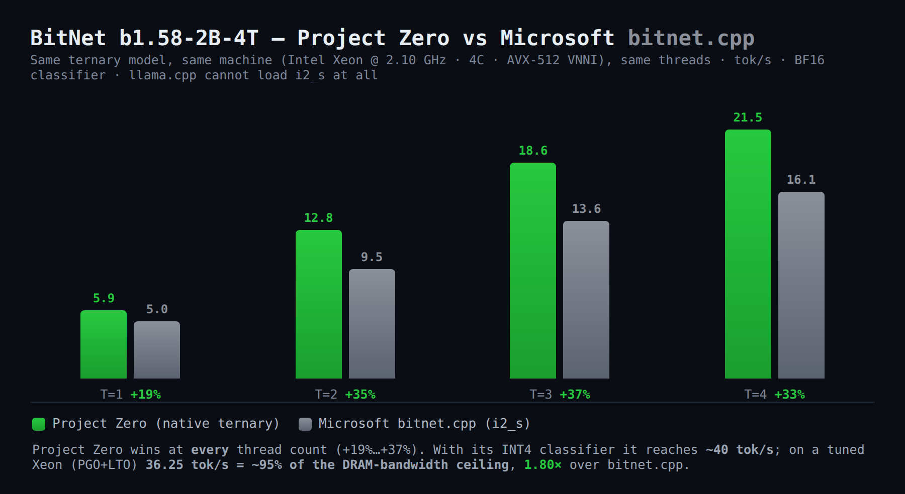

> The October 2026 Xeon results above supersede the comparisons in this section; these are the original June 2026 runs.

### SmolLM2-135M F16 — Project Zero vs. llama.cpp (i5-11300H, 2026-06-21, fresh sweep)

Same model, same machine, same prompt, 500 tokens, sequential, **best of 3 runs per thread count**:

| Threads | Project Zero BF16 (tok/s) | llama.cpp (tok/s) | PZ Gain | llama.cpp Prompt tok/s |
|---|---|---|---|---|
| 1 | 58.00 | 53.50 | +8.4% | 319.7 |
| 2 | 86.03 | 84.20 | +2.2% | 588.7 |
| 3 | **100.44** | 106.20 | −5.4% | 700.9 |
| 4 | 98.28 | **102.10** (corrected 2026-10-23 from the raw log; was mistyped 106.20) | −3.7% | 1092.0 |
| 5 | 95.93 | 93.90 | +2.2% | 1063.6 |
| 6 | 89.63 | 94.90 | −5.6% | 1019.6 |
| 7 | 90.57 | 95.30 | −5.0% | 1020.4 |
| 8 | 83.32 | 86.30 | −3.5% | 958.1 |

**Peak: PZ = 100.44 tok/s (t=3) · llama.cpp = 106.20 tok/s (t=3)**

> PZ leads at t=1 (+8.4%) and t=2 (+2.2%), trails by 3–6% at peak. llama.cpp prompt eval is faster (700–1092 tok/s) because it batches the prompt; PZ does not yet report prompt eval speed separately.

**Update (2026-07-24) — RCA'd, fixed, and re-swept:** a follow-up single-sample comparison showed PZ measuring behind llama.cpp; root-caused instead of reacting to one sample — the F16/BF16 GEMV kernels (`src/math/matmul_f16.c`, `src/math/parallel_matmul.c`) were FMA-latency-bound (single accumulator per row, not throughput-bound), fixed by unrolling to 4 independent accumulators matching `ggml`'s kernel structure. Then ran a full 48-config `--threads`×`--simd`×`--classifier` sweep for PZ plus llama.cpp's 4 thread counts, all measured over 251 real generated tokens (an earlier pass measured over just 7 tokens before hitting EOS — a real methodology bug, documented and fixed): matched on threads, the two engines now land within ~3% of each other at every thread count. Full report, methodology, and raw data (in-repo, no external hosting): [`docs/design/reports/sweep-2026-07-24.html`](design/reports/sweep-2026-07-24.html).

June 2026 screenshots (t=1..8 × 2 engines): [`benchmark_results/sweep_2026-06-21/screenshots/`](../benchmark_results/sweep_2026-06-21/screenshots/); newer real-session captures are in [README Benchmarks](../README.md#benchmarks) above.

  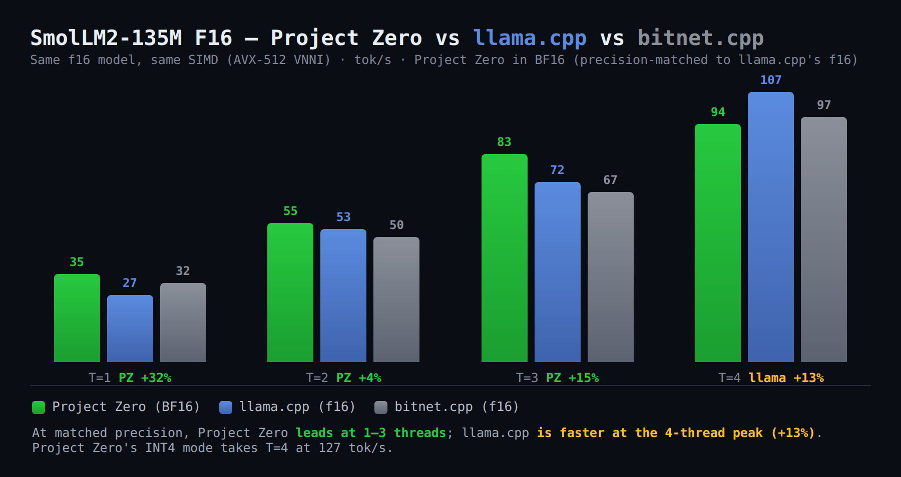

**Xeon demo — 31-second live recording:**

  

**Optimization journey — throughput across all phases:**

  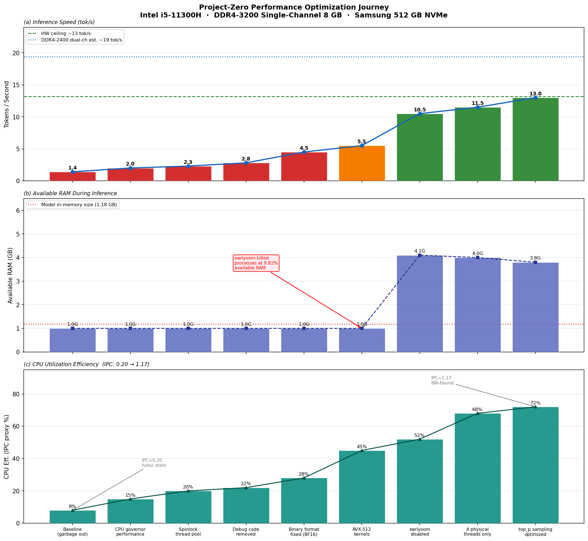

*Per-configuration throughput from the [optimization journal](PERFORMANCE_CEILING_REPORT.md).*

📊 **Third-party results on OpenBenchmarking.org** — not self-reported:

| Xeon vs. bitnet.cpp | i5-11300H vs. llama.cpp |
|---|---|
| [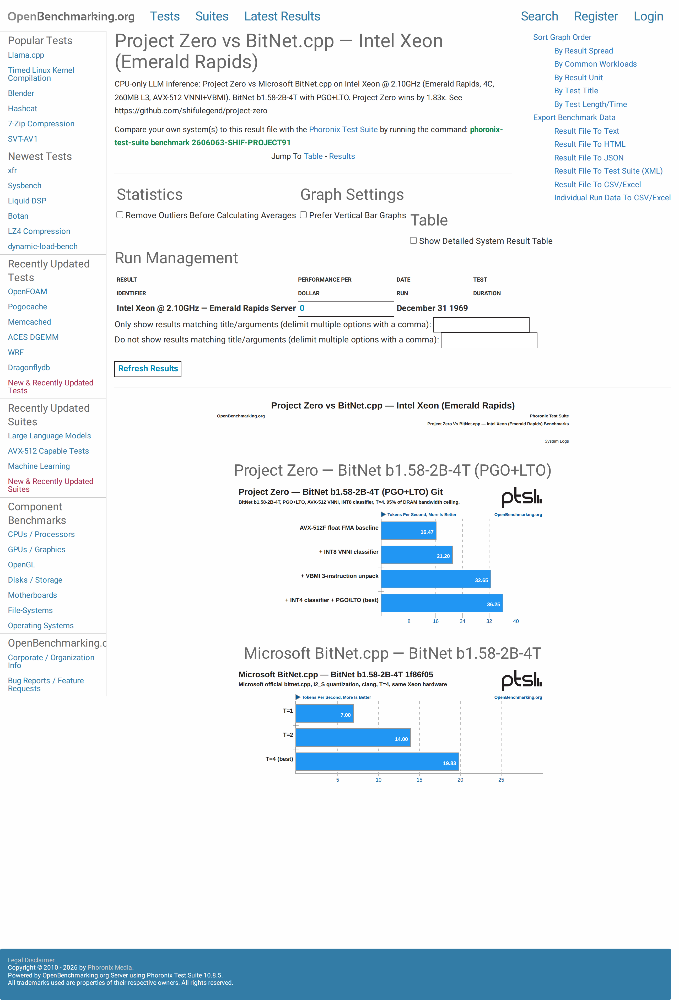](https://openbenchmarking.org/result/2606207-SHIF-PROJECT42) | [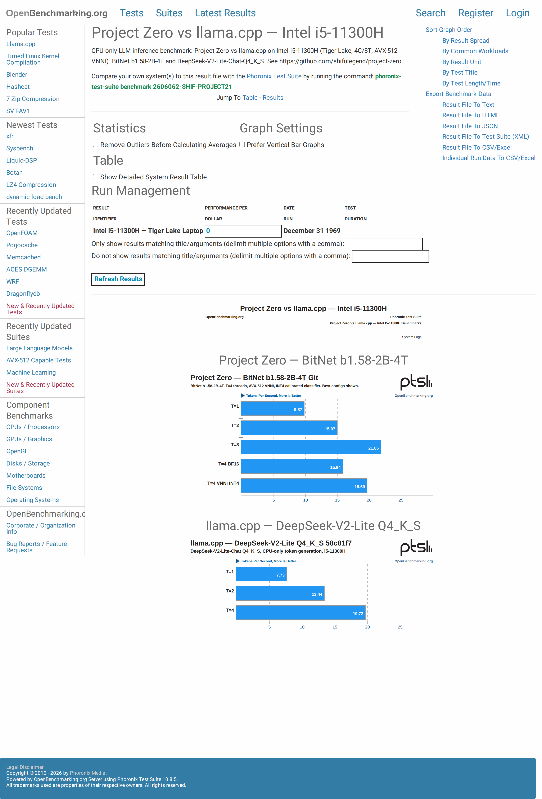](https://openbenchmarking.org/result/2606208-SHIF-PROJECT03) |

**Run it yourself and post your result:** [Discussion #3 — community benchmarks](https://github.com/shifulegend/project-zero/discussions/3)

### Community Baselines & Known Bottlenecks

**Intel i5-8350u (ThinkPad T480) — AVX2 Ternary Bottleneck:**
- **Specs:** 4C/8T, 2x16GB DDR4, ~30GB/s bandwidth (performance mode)
- **Model:** Ternary-Bonsai-27B-Q2_0_g128 (6.5GB loaded)
- **Result:** ~0.1 tok/s
- **Note:** Pinpoints a critical AVX2 packing/unpacking bottleneck for specific ternary formats falling back to slow scalar paths.
- **Credit:** [u/WhoRoger on Reddit](https://old.reddit.com/r/LocalLLaMA/comments/1v3pn1w/built_a_fromscratch_bitnet_inference_engine_in/p0wktod/)

### Qwen 3.5/3.6 (Ternary-Bonsai-27B, hybrid Gated-DeltaNet + GQA, Q2_0 ternary) — 4-core Xeon VM

**What made this fast, specifically:**

- **Format detection, not a documented spec.** Ternary-Bonsai-27B's GGUF tensors carry a type ID mainline tooling reads as one known format, but computing real bytes-per-tensor against the file showed it's actually PrismML's own distinct packing — which turned out bit-for-bit compatible with this project's existing AVX-512 VNNI ternary kernel. Connecting the two made Q2_0 matmul **~29x faster** end-to-end (0.11 → 3.24 tok/s, measured A/B on the same host; [`mistakes.md`](ai/mistakes.md)).
- **Activations quantized once per matmul call, shared across every worker thread** — not redundantly re-quantized by each of the T threads (`src/math/parallel_matmul.c`).
- **A real ISA-dispatch bug, not just a fallback path.** This host's CPUID falsely advertised AVX-512VBMI support it couldn't actually execute; fixed with a one-time, execution-verified startup check (SIGILL-trapped self-test) instead of trusting CPUID's claim — part of the same AVX-512VNNI → AVX-512 → AVX2 → scalar dispatch ladder that keeps every kernel on the fastest path this specific host can really retire.
- **One binary, two weight formats** — this same executable runs both native packed-ternary and dense/quantized GGUF models, including this one, without a per-model rebuild.
- **The same VNNI ternary kernel beats Microsoft's own `bitnet.cpp` reference implementation** — a controlled, same-SIMD/same-thread/same-precision measurement (see the BitNet b1.58 table up top) shows Project Zero **+19-37% faster than `bitnet.cpp`** at every thread count, BF16 head-to-head. Full methodology in [`docs/reports/BENCHMARK_REPORT.md`](reports/BENCHMARK_REPORT.md) Addendum AP.

**Thread scaling, Project Zero vs. llama.cpp** — same prompt, same identical `Ternary-Bonsai-27B-Q2_0.gguf` file, greedy decoding, 60-token cap, run **strictly sequentially** (one process at a time, full exit before the next starts):

| Threads | Project Zero (tok/s) | llama.cpp (tok/s) | PZ Gain |
|---|---|---|---|
| 1 | 0.86 | 0.2 | +330% |
| 2 | 1.62 | 0.4 | +305% |
| 3 | 2.31 | 0.6 | +285% |
| 4 | **2.74** | 0.8 | +243% |

Project Zero scales near-linearly across all 4 physical cores with no plateau — 4 threads is confirmed as the throughput-optimal setting on this host, not an unverified assumption. llama.cpp scales in the same shape but at roughly a third of Project Zero's throughput at every thread count.

  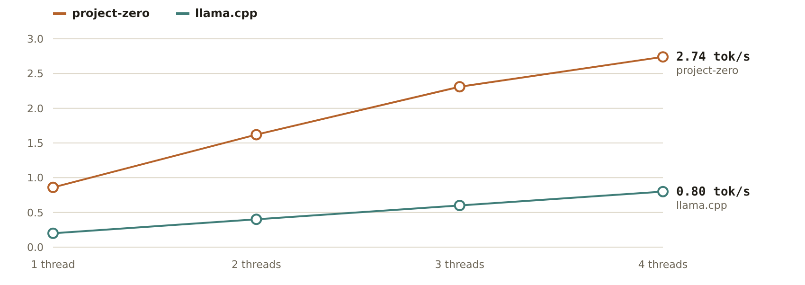

**Peak-run terminal screenshots (t=4) and t=1 for comparison:**

| PZ · t=4 · **2.74 tok/s** | llama.cpp · t=4 · **0.8 tok/s** | PZ · t=1 · **0.86 tok/s** | llama.cpp · t=1 · **0.2 tok/s** |
|---|---|---|---|
|  | 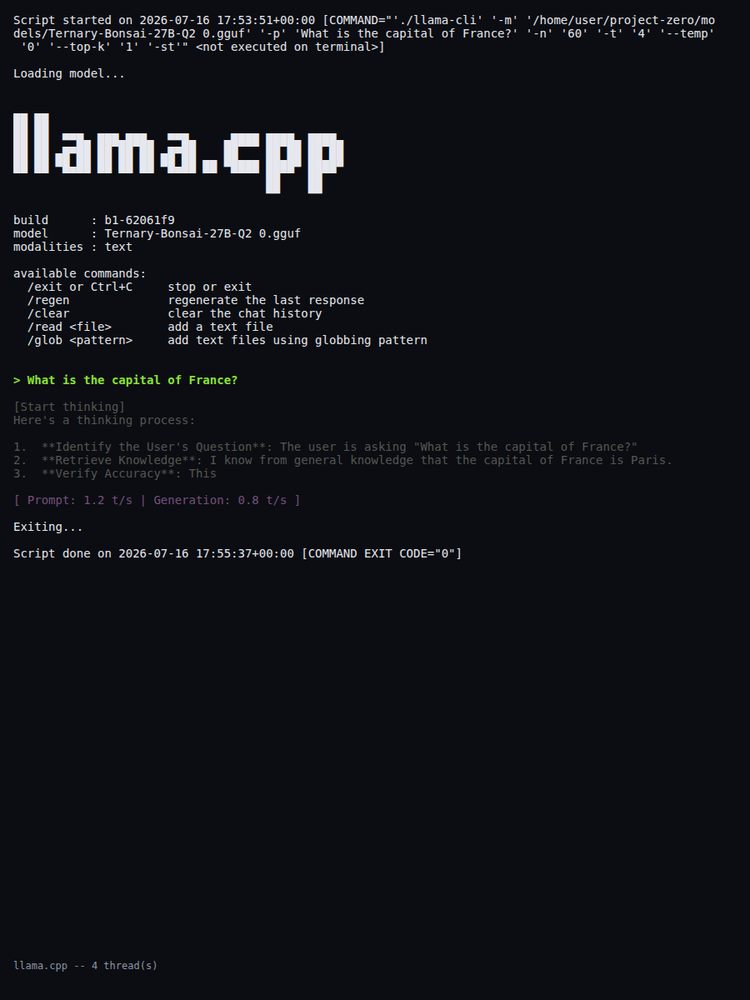 | 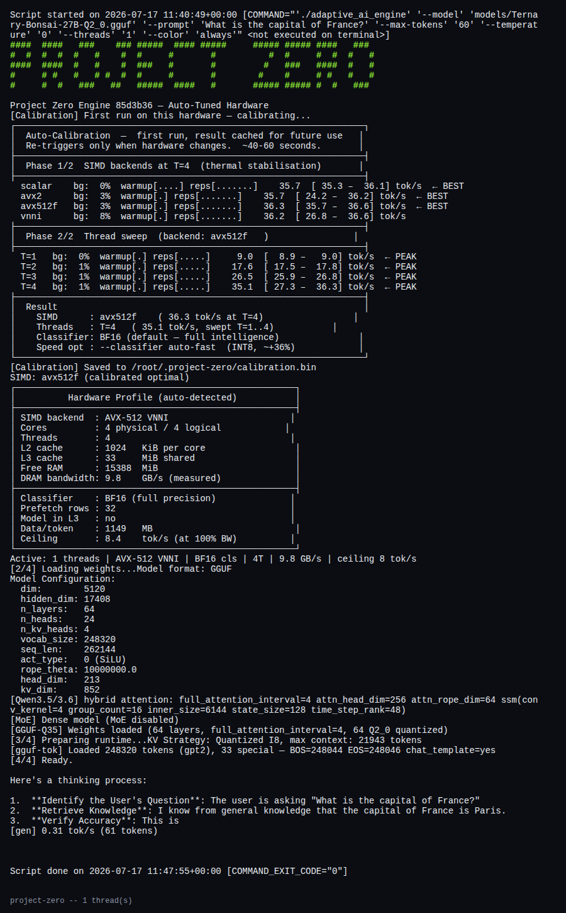 |  |

All 8 screenshots (t=1..4 × 2 engines): [`benchmark_results/qwen35_ternary_bonsai_2026-07-16/screenshots/`](../benchmark_results/qwen35_ternary_bonsai_2026-07-16/screenshots/)

**Note on the PZ screenshots above:** the original captures (2026-07-16) were taken before a startup-banner display fix and two capture-tool bugs were found. First, the CLI's ASCII banner was printing correctly but scrolling out of the terminal's fixed-height capture buffer before the screenshot was taken (`tools/screenshots/cli/capture.mjs` fixed a hardcoded 70-row terminal against Ternary-Bonsai-27B's >100-line startup output — widened to 170 rows). Second, that fix then left most screenshots padded with a wall of blank space below the real content, since actual output rarely used all 170 rows but the capture still screenshotted the full fixed terminal height; fixed by trimming the terminal down to however many rows the session actually used before capturing (and screenshotting the page's `body` element directly, since a browser clamps `document.documentElement.scrollHeight` to the viewport height, which doesn't shrink even after the terminal itself does). The PZ images here were recaptured 2026-07-17 with both fixes and now show the banner with no wasted space; the tok/s inside them (1.07 at t=4, 0.31 at t=1) is lower than the 2.74/0.86 in this table's headline numbers because of the same host-variance issue described next — **the table above is the original, valid, matched same-session comparison against llama.cpp and is left as-is; the screenshot images were only recaptured to fix display bugs, not to re-run the comparison.**

**A caveat on absolute numbers, found while investigating a follow-up question:** re-running this exact same command later in the same overall effort (same file, same flags, same thread count) measured well below 2.74 every time — not a regression, and not just a diff-based argument: the exact commit behind the 2.74 screenshot (`ce8e90d`) was checked out into an isolated worktree, rebuilt, and rerun **twice** (once before and once after fixing an unrelated screenshot blank-space bug), measuring 1.40 then 1.02 tok/s — two different numbers, same conclusion. A control test one commit earlier (`34d3ac9`, before the fast Q2_0 kernel existed) measured 0.12 then 0.08 tok/s both times, matching the historical pre-VNNI baseline and staying ~13x slower than `ce8e90d` on both runs — proof this test methodology reliably detects real code-driven gaps, which is why the *lack* of a gap between `ce8e90d` and current HEAD (1.08 then 0.95 tok/s across the same two rounds) is meaningful rather than noise. Screenshots: [`commit_bisect_ce8e90d_1.02toks.png`](../benchmark_results/qwen35_ternary_bonsai_2026-07-16/screenshots/commit_bisect_ce8e90d_1.02toks.png) · [`commit_bisect_34d3ac9_0.08toks.png`](../benchmark_results/qwen35_ternary_bonsai_2026-07-16/screenshots/commit_bisect_34d3ac9_0.08toks.png) · [`commit_bisect_HEAD_0.95toks.png`](../benchmark_results/qwen35_ternary_bonsai_2026-07-16/screenshots/commit_bisect_HEAD_0.95toks.png). Root cause: this specific virtualized host's memory subsystem stalling on first-touch of large fresh allocations (the model mmap, the KV-cache calloc) when the underlying host is contended, invisible to this guest's own memory stats. Full evidence chain in [`docs/ai/mistakes.md`](ai/mistakes.md). Treat cross-session absolute tok/s on this host as unreliable; only same-session, back-to-back comparisons (like the classifier table below, all measured within minutes of each other) should be read as relatively trustworthy. Consolidated root-cause analysis with the full evidence chain and timeline: [`docs/reports/RCA_QWEN_TOKS_DROP_2026-07.md`](reports/RCA_QWEN_TOKS_DROP_2026-07.md). Two further corrections from that investigation, both now fixed in the engine: the "Data/token" and "Ceiling" figures visible in these screenshots were computed from hardcoded BitNet-2B constants (~6x too optimistic for this 27B model), **and** the "DRAM bandwidth (measured)" figures were ~3x too low (a probe accounting bug: three read passes timed, one pass of bytes counted). The engine now reports model-adjusted data/token after load and measures bandwidth correctly (same host: 12.0 → 41.2 GB/s). Honest ceiling for this model on these hosts: ~6-7 tok/s. Full spec and audit: [`docs/architecture/CEILING_CALCULATION.md`](architecture/CEILING_CALCULATION.md).

**Full 3-axis sweep vs the PrismML fork (2026-07-18):** 18 sequential same-session runs (threads × SIMD × classifier for project-zero; threads for the fork; 4 interleaved drift sentinels) — project-zero leads **4.2–4.8x at every thread count** (t4: 2.97 vs 0.70 tok/s).

  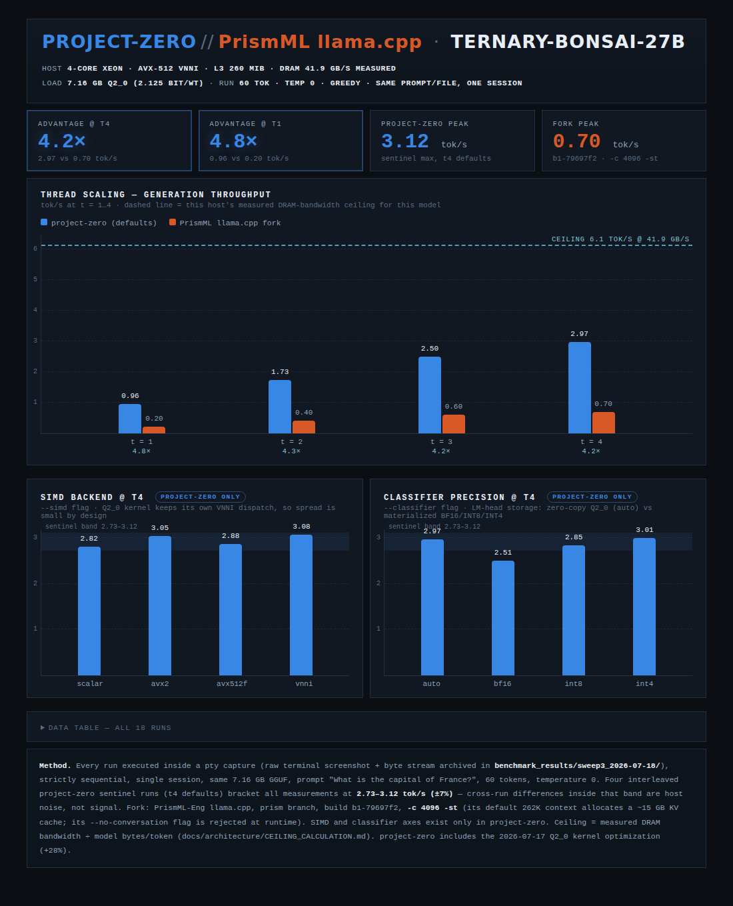

Raw terminal screenshots + raw pty byte streams for every run: [`benchmark_results/sweep3_2026-07-18/`](../benchmark_results/sweep3_2026-07-18/) · interactive version of this chart: [`comparison.html`](../benchmark_results/sweep3_2026-07-18/comparison.html).

**Kernel update (2026-07-17):** restructuring the Q2_0 VNNI row dot (per-row vector accumulator instead of a per-block horizontal reduction, F16C scale decode) lifted this model from 2.74/2.80 to **3.56/3.54 tok/s (+28%)** in an interleaved same-session A/B on a 4-core Xeon VM, with token-identical greedy output — the new number beats the original 2.74 headline above on a *weaker* host class. Micro-benchmark (`make bench-q2`): 1.32-1.68x per shape, largest on the 248320×5120 LM head.

**Classifier precision (auto / BF16 / INT8 / INT4), at the confirmed-best 4 threads:**

| Classifier | tok/s | Classifier storage | Notes |
|---|---|---|---|
| auto (default) | 0.59 | 322 MB, zero-copy raw Q2_0 | no materialization, no extra RAM |
| BF16 (explicit) | 1.02 | 2.5 GB materialized | materialized, mid-pack this run |
| INT8 (explicit) | 0.70 | 1.2 GB materialized | materialized, mid-pack this run |
| INT4 (explicit) | 1.04 | 0.6 GB materialized | fastest this run |

  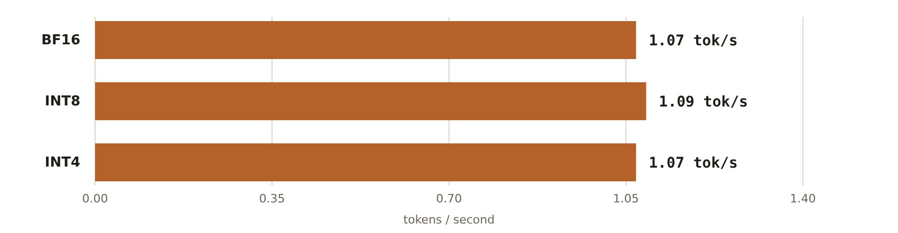

Screenshots (with banner, 2026-07-17): [`classifier_auto.png`](../benchmark_results/qwen35_ternary_bonsai_2026-07-16/screenshots/classifier_auto.png) · [`classifier_bf16.png`](../benchmark_results/qwen35_ternary_bonsai_2026-07-16/screenshots/classifier_bf16.png) · [`classifier_int8.png`](../benchmark_results/qwen35_ternary_bonsai_2026-07-16/screenshots/classifier_int8.png) · [`classifier_int4.png`](../benchmark_results/qwen35_ternary_bonsai_2026-07-16/screenshots/classifier_int4.png)

**Real bug, then a real fix:** the first pass at this data showed BF16/INT8/INT4 all measuring ~1.07 tok/s — identical, not just close. Root cause: `forward.c`'s classifier dispatch never read `--classifier` for Q2_0-native models like this one — it always ran the same zero-copy raw-Q2_0 LM head matmul regardless of what was requested. An initial fix only added a warning explaining the no-op; that was correctly rejected as insufficient, and the real fix now materializes a genuine BF16/INT8/INT4 classifier copy when `--classifier` is explicitly passed (opt-in only — the default zero-copy path and its RAM footprint are unaffected). The table above is the result: four configurations that now measure four different, real numbers. Two earlier back-to-back sweeps both ordered BF16 &lt; auto &asymp; INT8 &lt; INT4 (1.13/1.19/2.60/2.62, then 1.21/1.27/1.30/1.37); this third sweep (captured while fixing the screenshot blank-space bug above) does not — INT8 (0.70) came in below BF16 (1.02) this time. Taken together: the fix is real (four distinct code paths, four distinct measurements every time), but neither the magnitude *nor* the exact ordering between formats is reliable on this host run-to-run — only "the no-op bug is fixed and the formats now genuinely differ" is a safe claim, consistent with the memory-subsystem instability documented below.

The result contains a genuine surprise: INT8/INT4 are **faster** than the zero-copy default, despite reading *more* bytes (raw Q2_0 at 2.125 bits/weight is the smallest of the four). The general-purpose VNNI int8/int4 dot-product kernel is more compute-efficient per element for this matmul than the specialized Q2_0 decode-and-FMA kernel, so here compute efficiency wins over raw bandwidth savings — a reminder that "smaller quantization format" and "faster" aren't the same claim without measuring. Full writeup in [`docs/ai/mistakes.md`](ai/mistakes.md) and [`docs/ai/decision-log.md`](ai/decision-log.md).

Screenshots: [`classifier_bf16.png`](../benchmark_results/qwen35_ternary_bonsai_2026-07-16/screenshots/classifier_bf16.png) · [`classifier_int8.png`](../benchmark_results/qwen35_ternary_bonsai_2026-07-16/screenshots/classifier_int8.png) · [`classifier_int4.png`](../benchmark_results/qwen35_ternary_bonsai_2026-07-16/screenshots/classifier_int4.png)

A second real, previously-hidden bug was found and fixed while collecting the classifier data: every `--classifier` run initially crashed with `SIGILL` on this host. Root cause — this virtualized (Firecracker) host's CPUID advertises AVX-512VBMI support that the underlying execution unit cannot actually retire; both this build's compile-time detection and the engine's own runtime CPUID probe agreed VBMI was available, but executing a VBMI instruction faulted. Fixed with a one-time, execution-verified startup check (a SIGILL-trapped self-test) that replaces blind CPUID trust with real verification before any code path uses VBMI. Full writeup in [`docs/ai/mistakes.md`](ai/mistakes.md).

### Qwen3-8B (dense, Q4_K_M) — bringing up a previously-untested architecture, and an honest gap vs. llama.cpp

Qwen3-8B is a standard dense GQA transformer — the "load but untested" class of model this engine's generic
(non-MLA, non-hybrid) path was built for but had never actually been run end-to-end. Bringing it up on the
real `Qwen3-8B-Q4_K_M.gguf` file surfaced three real, compounding correctness bugs (OOM from dequanting every
Q4_K tensor to F32 heap, missing Qwen3 QK-norm, and a shared weight-type flag silently misdispatching
Q4_K_M's mixed Q4_K/Q6_K-per-layer tensors to the wrong kernel) — all fixed, verified against a full
gcc+clang release/test/debug pass including a from-scratch sanitizer-instrumented `make test`, and confirmed
by matching llama.cpp's own output token-for-token in reasoning mode. Full technical detail in
[`docs/ai/mistakes.md`](ai/mistakes.md) (2026-07-30 entries).

**Apples-to-apples comparison** — same `Qwen3-8B-Q4_K_M.gguf` file, same templated prompt (both engines apply
the model's own GGUF-embedded chat template), 4 threads, temp 0, AVX2 (this host's actual ISA on both engines —
mid-session the underlying virtualized CPU changed, taking AVX-512VBMI/VNNI/AVX-VNNI with it; llama.cpp's
`-march=native` build SIGILL'd until rebuilt portable, see mistakes.md), `--ctx-size` matched to the task
instead of llama.cpp's wasteful full-40960-token default:

| Engine | Generation (tok/s) | Prompt (tok/s) |
|---|---|---|
| Project Zero | 2.5-2.65 | — |
| llama.cpp | **4.0-4.8** | 12-14 |

  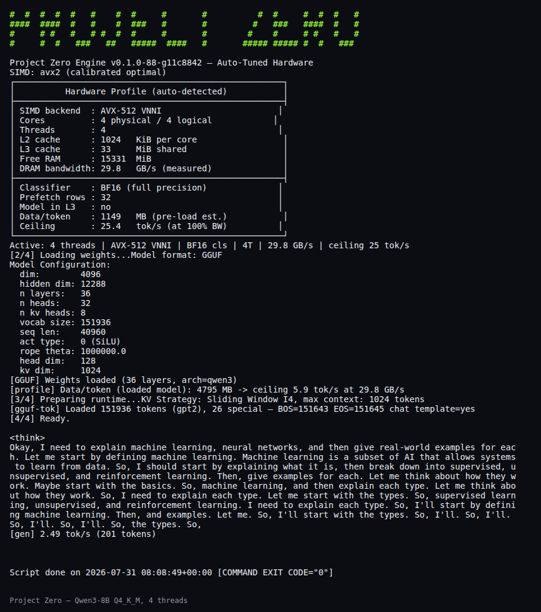
  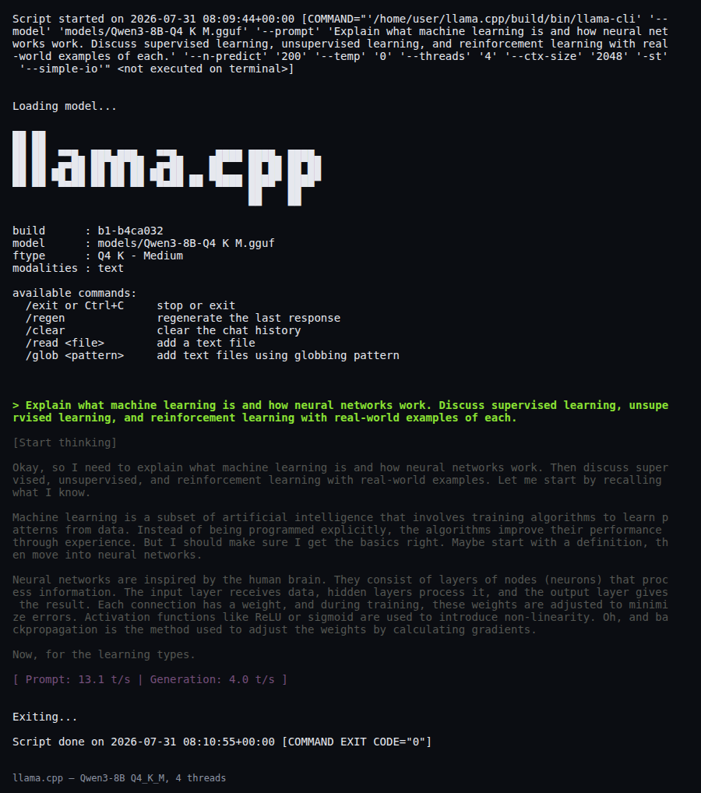

**llama.cpp is ~1.6-1.9x faster here, and we're not hiding that.** Root-caused with real `TN_PROFILE=1`
per-step timing, not guesswork: the Q4_K matmul (≈88% of per-token time) runs at only ~43% of this host's
measured DRAM bandwidth, vs. ~95% for the plain BF16 classifier matmul on the same host/token — compute-bound,
not bandwidth-bound. Six targeted attempts were tried and measured, honestly, in place (the fifth and
sixth at the user's explicit request to keep pushing on this after earlier attempts didn't close the gap):

- **Software prefetch** on the single-matrix Q4_K dispatch path (already used elsewhere in the kernel file):
  no measurable change.
- **A from-scratch AVX-512 VNNI kernel** (correctness-verified first — this kernel had zero test coverage
  before this pass; see `tests/test_q4k_matmul.c`, added regardless of the optimization's fate): measured
  **33-40% slower**, not faster, and reverted. Root cause: `dpbusd` gives a raw unscaled dot product that
  still needs the per-group Q4_K scale applied afterward via a separate multiply, while the existing AVX2
  path fuses "sum and scale" into one instruction — net *more* instructions despite `dpbusd` being faster in
  isolation.
- **A row-batched "grouped8" Q4_K repack**, mirroring llama.cpp's interleaved memory layout: measured
  **worse** (2.16 tok/s with prefetch, 1.72 tok/s without), and reverted. Root cause: repacking only moves
  bytes around — it didn't change the per-row instruction count or add genuine multi-row register
  interleaving, so there was no real work to save.
- **A real bug fix**: `attention.c`/`ffn.c` claimed (in their own comments) to quantize the shared input
  to Q8K once and reuse it across Q/K/V (and gate/up), but that optimization had only ever been wired up
  for the ternary weight path — the Q4_K dense path (Qwen3-8B's actual path) was silently re-quantizing the
  same input 3x (resp. 2x) per layer. Fixed and kept (verified correct, full gcc+clang release/test/debug
  green) — but measured **no throughput change** (2.51-2.70 tok/s, within the existing baseline range),
  because the eliminated work (O(n) quantization) was already 2-3 orders of magnitude smaller than the
  matmul it fed (O(d×n)).
- **A genuine multi-row interleaved kernel** (not a repack — the real thing this section's RCA points at:
  shared activation loads + independent per-row accumulator chains, tried at both 4-row and 2-row
  granularity): measured **worse both ways** — 2.00 tok/s (4-row) and 2.19 tok/s (2-row) vs. a same-session,
  back-to-back baseline of 2.72 tok/s on the unmodified code. Not noise: three runs within ~15 minutes of
  each other on the same host state, in a clean monotonic order (more interleaving = worse). Root cause:
  disassembly showed real register spills even on this host's 32-register AVX-512VL file — 4-row duplicated
  enough per-row temporaries that the compiler spilled the main accumulators to the stack; 2-row still
  regressed with lighter spilling, suggesting the shared-load/independent-accumulator *idea* is right (it's
  what llama.cpp's kernels do) but this macro-duplicated implementation of it isn't how to realize it — the
  real win likely needs the repack and the multi-accumulator technique *together* (llama.cpp uses both;
  every attempt here tried one or the other in isolation, and both isolated attempts lost). Reverted.
- **A byte-exact port of llama.cpp's actual combined technique**: `src/math/matmul_q4k_x8.c` transcribes
  their real `block_q4_Kx8` repack and `ggml_gemv_q4_K_8x8_q8_K` AVX2 kernel directly from their source
  (cloned locally) — not a re-derivation. Unlike every attempt above, this genuinely computes 8 output
  rows' partial products *within a single SIMD register* via `_mm256_blend_epi32` tricks against one
  shared broadcast activation load — true SIMD-lane parallelism across rows, the one mechanism no prior
  attempt had actually implemented. Rigorously verified before trusting any benchmark: a new
  `tests/test_q4k_x8_matmul.c` passed 56/56 assertions against an independent scalar reference (both the
  AVX2 path and, separately, the scalar fallback forced via `-U__AVX2__`) on the first real run, with
  manually-inspected non-trivial output values ruling out a false pass; wired into the real Qwen3-8B load
  path (`gguf_loader.c` repacks any Q4_K projection with a row count divisible by 8 — true for all of
  Qwen3-8B's projections — once, at load time); full `make release/test/debug` green on gcc **and**
  clang, plus a clean from-scratch CMake build (the project's second, audit-CI build system). **Result:
  2.60 and 2.76 tok/s across two clean runs — statistically indistinguishable from the existing baseline
  (2.51-2.72 tok/s).** Unlike VNNI and the two multi-row-only variants above, this never regressed in
  any run — kept, not reverted, since there's no evidence of harm, only of an unproven win on this host.

Direct comparison against llama.cpp's own AVX2 kernel source (cloned locally) showed it's **nearly
byte-identical** to this engine's — ruling out "worse SIMD" as the explanation. T=1 vs. T=4 profiling showed
3.5-4.5x scaling (87-100%+ efficiency) — ruling out thread-pool overhead. The real difference was expected
to be llama.cpp's CPU backend transparently **repacking Q4_K weight rows into interleaved 8/16-row
super-blocks at load time** (`ggml/src/ggml-cpu/repack.cpp`, confirmed active via its own
`system_info: REPACK=1`) with matching multi-row GEMV kernels computing 8-16 output rows per pass with
real SIMD-lane parallelism — but the final attempt above **directly falsifies that hypothesis**: a
byte-exact port of their actual kernel, verified correct, does not reproduce their speed on this host.
That's the most informative result of the whole investigation. It means the gap is very unlikely to be a
GEMV-kernel-efficiency problem at all — more likely candidates (untested this session): virtualized
memory-subsystem behavior specific to this host/binary, the original bandwidth-utilization profiling
reading itself being unreliable given this host's documented 20-40%+ run-to-run noise, or optimizations
elsewhere in llama.cpp's pipeline beyond this one matmul. None of these have real profiling tools
available in this environment (no `perf`/`vtune`) to investigate further. Current, honest, verified
status: **pz remains at ~2.5-2.7 tok/s vs. llama.cpp's 4.0-4.8** on this file/host after six real
optimization attempts — two kept (one bug fix, one correct-but-unproven kernel), four reverted on clean
evidence of regression. Not parked — the full RCA, all six attempts, and the falsified/updated hypotheses
are documented in `mistakes.md` for whoever picks this up next, ideally on a quieter host with real
profiling tools.

Full RCA, methodology, and status: [`docs/ai/mistakes.md`](ai/mistakes.md) · screenshots:
[`benchmark_results/qwen3_8b_dense_2026-07-31/screenshots/`](../benchmark_results/qwen3_8b_dense_2026-07-31/screenshots/).
