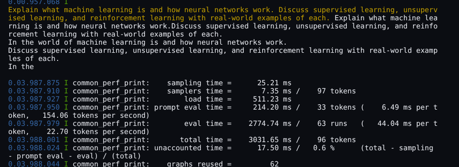
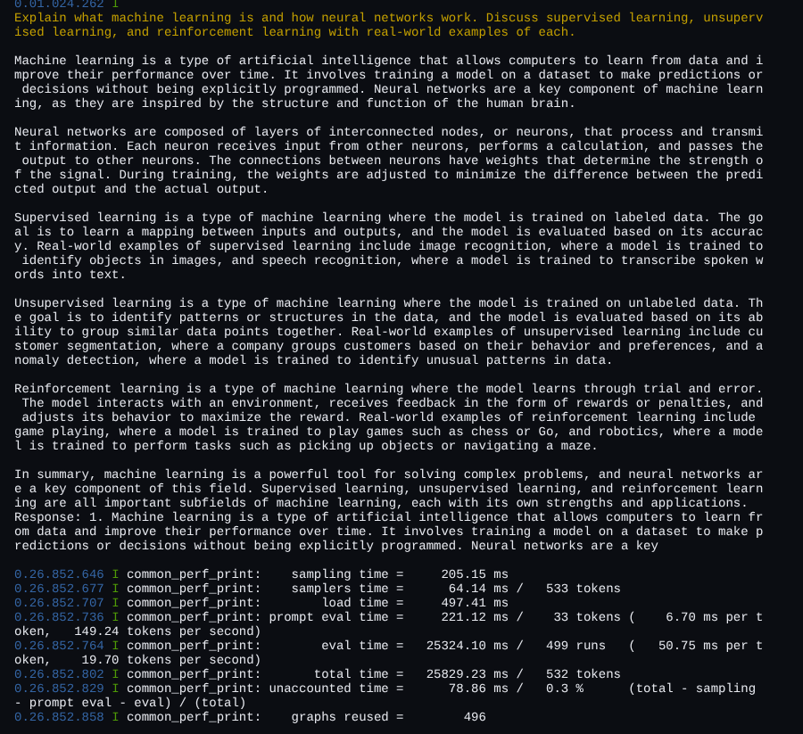

Draft comment for microsoft/BitNet issue #602 (target chosen: the issue, not PR #605; see the note at the end).
Everything below the line is the comment text.

---

Independent measurements that confirm this report, with before/after numbers.

**What we saw.** On `bitnet-b1.58-2B-4T-i2_s.gguf` (arch `bitnet-b1.58`), BitNet `main` at `0b341e5` repeats itself with greedy decoding, and perplexity is far above what a correct build gives. The cause is the one in this issue: `src/models/bitnet.cpp` builds the FFN with `LLM_FFN_SILU`, while the model config says `hidden_act: relu2`.

**Numbers** (Intel Xeon 2.10 GHz, 4 threads, greedy, same GGUF, same build flags; only the FFN activation differs):

| build | perplexity (ctx 512, 8 chunks) | `The capital of France is` |
|---|---|---|
| `0b341e5` as is (SiLU) | **48.67** | not "Paris" |
| `0b341e5` + one-line change to `LLM_FFN_RELU_SQR` | **31.33** | " Paris. ..." |

The text is a fixed 8-chunk English passage, [gate_text.txt](https://raw.githubusercontent.com/shifulegend/project-zero/7a9240b9215b26da7cbcc0c885867ce21c566a49/tools/bench/gate_text.txt). A second, from-scratch engine (pz) reaches 31.37, and ik_llama.cpp's graph (which uses squared ReLU) answers "Paris", so the fixed value is consistent across implementations.

**Screenshots** (raw terminal output; `-n 64`/`-n 500`, `--temp 0`, `--ignore-eos`, 4 threads, prompt "Explain what machine learning is and how neural networks work. Discuss supervised learning, unsupervised learning, and reinforcement learning with real-world examples of each."):

Before (SiLU, loops after the first sentence):



After (one-line change to `LLM_FFN_RELU_SQR`, coherent answer with one paragraph per topic):



**Where the activation goes wrong.** Layer 0, BOS token, `ffn_down-0`, first three values, from an independent numpy implementation written only from the GGUF bytes ([bitnet_layer0.py](https://raw.githubusercontent.com/shifulegend/project-zero/7a9240b9215b26da7cbcc0c885867ce21c566a49/tools/bench/verify/bitnet_layer0.py)):

| | values |
|---|---|
| numpy, squared ReLU | 0.46, 24.03, -36.88 |
| numpy, SiLU | -33.49, 86.64, -81.20 |
| `llama-eval-callback`, `0b341e5` | -35.54, 88.23, -80.71 |

Everything before the FFN activation matches the numpy reference (`Vcur-0` agrees to 4 digits), and the graph shows a `SWIGLU` op with `-0.0` where squared ReLU gives `+0.0`. Not the cause: tokenizer (same 33 token IDs), AVX2 vs AVX-512/VNNI (rebuilt with AVX2 only, identical text), batching, repack, thread count.

**The change** ([patch](https://raw.githubusercontent.com/shifulegend/project-zero/7a9240b9215b26da7cbcc0c885867ce21c566a49/tools/bench/patches/bitnetcpp-ffn-relu-sqr.diff)):

```diff
--- a/src/models/bitnet.cpp
+++ b/src/models/bitnet.cpp
@@ -130,7 +130,7 @@
-                LLM_FFN_SILU, LLM_FFN_PAR, il);
+                LLM_FFN_RELU_SQR, LLM_FFN_PAR, il);
```

**Reproduce**

```
git clone --recursive https://github.com/microsoft/BitNet && cd BitNet && git checkout 0b341e5
# build as in the README (clang, Release), then:
build/bin/llama-perplexity -m bitnet-b1.58-2B-4T-i2_s.gguf -f gate_text.txt -c 512 --chunks 8   # 48.67
git apply bitnetcpp-ffn-relu-sqr.diff && rebuild
build/bin/llama-perplexity -m bitnet-b1.58-2B-4T-i2_s.gguf -f gate_text.txt -c 512 --chunks 8   # 31.33
build/bin/llama-completion -m bitnet-b1.58-2B-4T-i2_s.gguf -p "The capital of France is" -n 24 --temp 0 -no-cnv
```

Since the architecture string is the same for every file, a fix that reads the activation from the model (as in #605) is better than hard-coding the change above. A perplexity check on a fixed text in `utils/`, with a threshold, would have caught this.

---

Why #602 and not #605: #602 is the bug report, so before/after numbers, screenshots and a repro belong there, and they stay useful whichever fix lands. I could not open either thread from this environment, so I did not check the current state of #605 (open/merged) or its diff; if it is still open, the owner may prefer to link this comment from there too.

Image paths (all pinned to commit `7a9240b9215b26da7cbcc0c885867ce21c566a49`, so the links keep working if the branch is deleted):
- docs/rca/img/bitnetcpp-silu-loop.png
- docs/rca/img/bitnetcpp-relu2-fix.png
Also linked: tools/bench/gate_text.txt, tools/bench/verify/bitnet_layer0.py, tools/bench/patches/bitnetcpp-ffn-relu-sqr.diff.
Checked for private data: no hostnames, IPs, user names, e-mail addresses or local paths; the screenshots are cropped to the generated text and timing lines.
